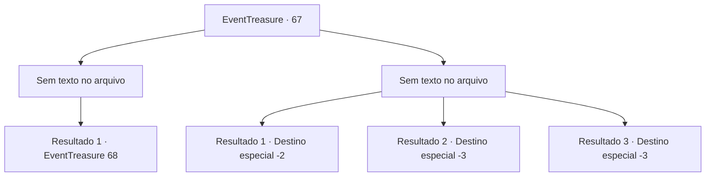

# Eventos de tesouro · 67

[Índice da tabela](index.md) · [Índice geral](../index.md)

ID: `pt:EventTreasure:67` · Fonte: `EventTreasure4` · Versão: 1.2.47.

Mapeamento estático dos arquivos; a disponibilidade e a execução dependem do estado da run.

## Texto do evento

*Sem texto no arquivo.*

## Dados de entrada

```json
{
  "id": 67,
  "grade": 1,
  "place": "",
  "required": ""
}
```

## Mapa das escolhas



## Escolhas e resultados

### Escolha 1

*Sem texto no arquivo; o papel dessa opção depende da interface do jogo.*

Requisitos e outros campos da escolha:

```json
{
  "required": ""
}
```

#### Resultado 1.1

Você esmigalha o Golem de Ferro em pedaços. Ele não mais está em seu caminho, e você caminha confiante para o salão. |drawing_hallOfperseryuse| Dentro do salão parece uma zona de guerra, com colunas destroçadas e armas enferrujadas espalhados por toda parte. No fim da alta escadaria, há uma estátua de bronze de uma deusa e um trono de mármore. Enquanto sobe as escadas, alguém sai de um lugar que definitivamente estava vazio. Ele está calçando sandálias aladas, e segura uma espada com uma lâmina curvada, e um escudo de bronze. 

 "Argh... prazer te conhecer. Eu estava morrendo de tédio, e um novo amigo aparece. O que você está fazendo? Saque sua arma."


Continuação registrada: [Evento 68](0068.md) na mesma tabela.

```json
{
  "required": "",
  "chance": "1",
  "nextEvent": 68,
  "type": 2,
  "reward": ""
}
```

### Escolha 2

*Sem texto no arquivo; o papel dessa opção depende da interface do jogo.*

Requisitos e outros campos da escolha:

```json
{
  "required": ""
}
```

#### Resultado 2.1

Você é bloqueado pelo Golem de Ferro, e chutado pra fora do salão. Ferido, você caminha rumo à outro lugar, deixando o salão de Per-Sheryuse.

Continuação registrada: [Destino especial `-2`](../destinos-especiais.md).

```json
{
  "required": "1_1_2|1_0_2",
  "chance": "1",
  "nextEvent": -2,
  "type": 2,
  "reward": "0_0_-1|0_1_-1|5_107_9"
}
```

#### Resultado 2.2

Você é esmagado pelo punho do Golem de Ferro.

Continuação registrada: [Destino especial `-3`](../destinos-especiais.md).

```json
{
  "required": "2_0_2",
  "chance": "1",
  "nextEvent": -3,
  "type": 2,
  "reward": "0_0_-1|0_1_-1"
}
```

#### Resultado 2.3

Você é esmagado pelo punho do Golem de Ferro.

Continuação registrada: [Destino especial `-3`](../destinos-especiais.md).

```json
{
  "required": "2_1_2",
  "chance": "1",
  "nextEvent": -3,
  "type": 2,
  "reward": "0_0_-1|0_1_-1"
}
```

## Referências que chegam a este evento

- [Evento 66 · escolha 1 · resultado 1](0066.md#escolha-1)
