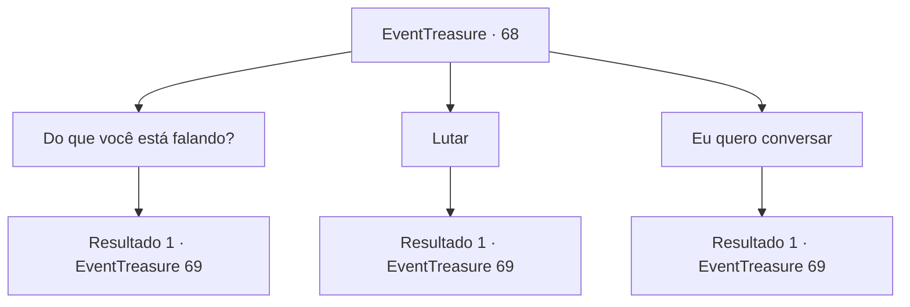

# Eventos de tesouro · 68

[Índice da tabela](index.md) · [Índice geral](../index.md)

ID: `pt:EventTreasure:68` · Fonte: `EventTreasure4` · Versão: 1.2.47.

Mapeamento estático dos arquivos; a disponibilidade e a execução dependem do estado da run.

## Texto do evento

*Sem texto no arquivo.*

## Dados de entrada

```json
{
  "id": 68,
  "grade": 1,
  "place": "",
  "required": ""
}
```

## Mapa das escolhas



## Escolhas e resultados

### Escolha 1

Do que você está falando?

Requisitos e outros campos da escolha:

```json
{
  "required": ""
}
```

#### Resultado 1.1

Em resposta à sua questão, ele enclina a cabeça, como se estivesse curioso. 

 "Você não está aqui para me desafiar? Eu escrevi que novos heróis são sempre bem-vindos. Ah, você é analfabeto?"

 Ele acena com a cabeça como se percebesse algo. Então ele puxa a espada curva da cintura, e continua. 

 "Bem... um herói reconhece outro. Nós não precisamos de palavras, não é?"


Continuação registrada: [Evento 69](0069.md) na mesma tabela.

```json
{
  "required": "",
  "chance": "1",
  "nextEvent": 69,
  "type": 2,
  "reward": "6_0_85",
  "place": 10
}
```

### Escolha 2

Lutar

Requisitos e outros campos da escolha:

```json
{
  "required": ""
}
```

#### Resultado 2.1

Você prepara a arma e se aproxima devagar. Após a calmaria antes da tempestade, ele ataca com a espada curva primeiro.

Continuação registrada: [Evento 69](0069.md) na mesma tabela.

```json
{
  "required": "",
  "chance": "1",
  "nextEvent": 69,
  "type": 2,
  "reward": "6_0_85",
  "place": 10
}
```

### Escolha 3

Eu quero conversar

Requisitos e outros campos da escolha:

```json
{
  "required": ""
}
```

#### Resultado 3.1

Você convida ele para uma conversa. Ele acena e fala com orgulho. 

 "Claro. Mas antes disso, vamos tirar um tempo para nos conhecermos melhor."

 Então ele puxa a espada curva da cintura. Aparentemente as conversas dele são feitas fisicamente.

Continuação registrada: [Evento 69](0069.md) na mesma tabela.

```json
{
  "required": "",
  "chance": "1",
  "nextEvent": 69,
  "type": 2,
  "reward": "6_0_85",
  "place": 10
}
```

## Referências que chegam a este evento

- [Evento 66 · escolha 2 · resultado 1](0066.md#escolha-2)
- [Evento 66 · escolha 4 · resultado 1](0066.md#escolha-4)
- [Evento 67 · escolha 1 · resultado 1](0067.md#escolha-1)
