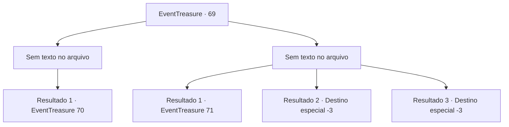

# Eventos de tesouro · 69

[Índice da tabela](index.md) · [Índice geral](../index.md)

ID: `pt:EventTreasure:69` · Fonte: `EventTreasure4` · Versão: 1.2.47.

Mapeamento estático dos arquivos; a disponibilidade e a execução dependem do estado da run.

## Texto do evento

*Sem texto no arquivo.*

## Dados de entrada

```json
{
  "id": 69,
  "grade": 1,
  "place": "",
  "required": ""
}
```

## Mapa das escolhas



## Escolhas e resultados

### Escolha 1

*Sem texto no arquivo; o papel dessa opção depende da interface do jogo.*

Requisitos e outros campos da escolha:

```json
{
  "required": ""
}
```

#### Resultado 1.1

Você derrota o herói antigo. Ele se senta e cai na gargalhada. 

 "Hahahah! Isso foi tão divertido. Teria sido uma luta ainda melhor se eu estivesse vivo... Que pena."

 Ele diz que vai te dar um de seus próprios tesouros.

Continuação registrada: [Evento 70](0070.md) na mesma tabela.

```json
{
  "required": "",
  "chance": "1",
  "nextEvent": 70,
  "type": 2,
  "reward": ""
}
```

### Escolha 2

*Sem texto no arquivo; o papel dessa opção depende da interface do jogo.*

Requisitos e outros campos da escolha:

```json
{
  "required": ""
}
```

#### Resultado 2.1

Você perde para o herói antigo. Enquanto você está deitado no chão, ele abre a boca, olhando pra você. 

 "Bem, isso não foi tão ruim. Ao menos eu posso te contar uma história por ter me entretido."

 Ele te entrega uma poção e questiona se você tem alguma pergunta.

Continuação registrada: [Evento 71](0071.md) na mesma tabela.

```json
{
  "required": "1_1_2|1_0_2",
  "chance": "1",
  "nextEvent": 71,
  "type": 2,
  "reward": "3_36_1|3_37_1|0_0_-1|0_1_-1|5_107_9"
}
```

#### Resultado 2.2

Você perde sua vida para o herói antigo. Ele que tirou sua vida desaparece logo.

Continuação registrada: [Destino especial `-3`](../destinos-especiais.md).

```json
{
  "required": "2_0_2",
  "chance": "1",
  "nextEvent": -3,
  "type": 2,
  "reward": "0_0_-1|0_1_-1"
}
```

#### Resultado 2.3

Você perde sua vida para o herói antigo. Ele que tirou sua vida desaparece logo.

Continuação registrada: [Destino especial `-3`](../destinos-especiais.md).

```json
{
  "required": "2_1_2",
  "chance": "1",
  "nextEvent": -3,
  "type": 2,
  "reward": "0_0_-1|0_1_-1"
}
```

## Referências que chegam a este evento

- [Evento 68 · escolha 1 · resultado 1](0068.md#escolha-1)
- [Evento 68 · escolha 2 · resultado 1](0068.md#escolha-2)
- [Evento 68 · escolha 3 · resultado 1](0068.md#escolha-3)
