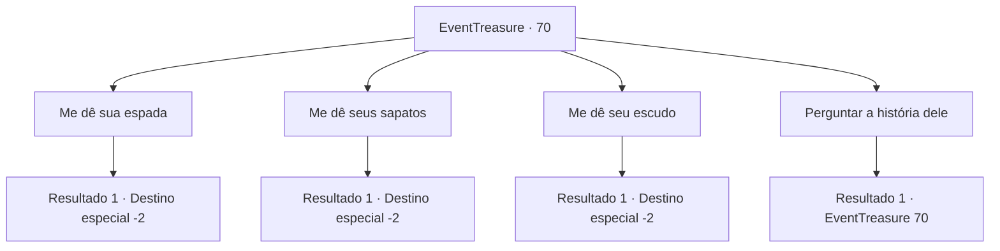

# Eventos de tesouro · 70

[Índice da tabela](index.md) · [Índice geral](../index.md)

ID: `pt:EventTreasure:70` · Fonte: `EventTreasure4` · Versão: 1.2.47.

Mapeamento estático dos arquivos; a disponibilidade e a execução dependem do estado da run.

## Texto do evento

*Sem texto no arquivo.*

## Dados de entrada

```json
{
  "id": 70,
  "grade": 1,
  "place": "",
  "required": ""
}
```

## Mapa das escolhas



## Escolhas e resultados

### Escolha 1

Me dê sua espada

Requisitos e outros campos da escolha:

```json
{
  "required": ""
}
```

#### Resultado 1.1

Você pede pela espada curva dele. Sem hesitar, ele puxa a lâmina da cintura e a entrega a você. 

 "Aqui está, Pegue, se você achar outros caras úteis, eu gostaria que você os enviasse para cá."

 Per-Sheryuse, após te entregar a arma, desaparece como uma miragem. Após receber a arma antiga, você deixa o salão.

Continuação registrada: [Destino especial `-2`](../destinos-especiais.md).

```json
{
  "required": "",
  "chance": "1",
  "nextEvent": -2,
  "type": 2,
  "reward": "3_146_1|5_107_9"
}
```

### Escolha 2

Me dê seus sapatos

Requisitos e outros campos da escolha:

```json
{
  "required": ""
}
```

#### Resultado 2.1

Você pede seus sapatos alados. Sem hesitar, ele tira os sapatos e os entrega a você 

 "Aqui está. Pegue. Se você encontrar outros caras úteis, eu gostaria que você os enviasse aqui."

 Per-Sheryuse, depois de entregar os sapatos, desaparece como uma miragem. Depois de receber o par de sapatos antigos, você sai do corredor.

Continuação registrada: [Destino especial `-2`](../destinos-especiais.md).

```json
{
  "required": "",
  "chance": "1",
  "nextEvent": -2,
  "type": 2,
  "reward": "3_147_1|5_107_9"
}
```

### Escolha 3

Me dê seu escudo

Requisitos e outros campos da escolha:

```json
{
  "required": ""
}
```

#### Resultado 3.1

Você pede seu escudo de aparência grotesca. Sem hesitar, ele lhe entrega o escudo. 

 "Aqui está. Pegue. Se você encontrar outros caras úteis, eu gostaria que você os enviasse aqui."

 Per-Sheryuse, depois de entregar o escudo, desaparece como uma miragem. Depois de receber o escudo antigo, você sai do salão.

Continuação registrada: [Destino especial `-2`](../destinos-especiais.md).

```json
{
  "required": "",
  "chance": "1",
  "nextEvent": -2,
  "type": 2,
  "reward": "3_148_1|5_107_9"
}
```

### Escolha 4

Perguntar a história dele

Requisitos e outros campos da escolha:

```json
{
  "required": "5_110_0"
}
```

#### Resultado 4.1

Você pergunta a ele que tipo de rancor trágico o prende a este mundo. Ele diz com uma explosão de risadas. 

 "Hahaha! Não. Eu só queria lutar mais. Fiz uma família, tive filhos e estabeleci um reino. E eu fechei meus olhos com conforto. Mas, implorei aos deuses porque queria saber sobre os heróis das gerações futuras. Para deixar minha alma aqui. Embora seja uma pena que não tenha mais ninguém para orar por eles."


Continuação registrada: [Evento 70](0070.md) na mesma tabela.

```json
{
  "required": "",
  "chance": "1",
  "nextEvent": 70,
  "type": 2,
  "reward": "5_110_1"
}
```

## Referências que chegam a este evento

- [Evento 69 · escolha 1 · resultado 1](0069.md#escolha-1)
- [Evento 70 · escolha 4 · resultado 1](0070.md#escolha-4)
