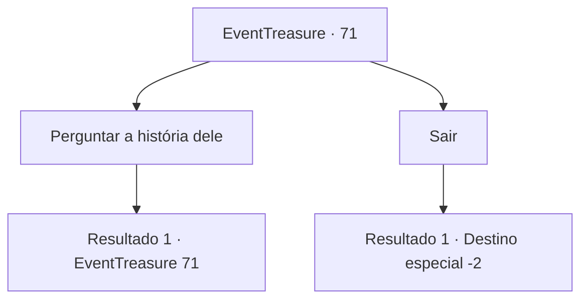

# Eventos de tesouro · 71

[Índice da tabela](index.md) · [Índice geral](../index.md)

ID: `pt:EventTreasure:71` · Fonte: `EventTreasure4` · Versão: 1.2.47.

Mapeamento estático dos arquivos; a disponibilidade e a execução dependem do estado da run.

## Texto do evento

*Sem texto no arquivo.*

## Dados de entrada

```json
{
  "id": 71,
  "grade": 1,
  "place": "",
  "required": ""
}
```

## Mapa das escolhas



## Escolhas e resultados

### Escolha 1

Perguntar a história dele

Requisitos e outros campos da escolha:

```json
{
  "required": "5_110_0"
}
```

#### Resultado 1.1

Você pergunta a ele que tipo de rancor trágico o prende a este mundo. Ele diz com uma explosão de risadas. 

 "Hahaha! Não. Eu só queria lutar mais. Fiz uma família, tive filhos e estabeleci um reino. E eu fechei meus olhos com conforto. Mas, implorei aos deuses porque queria saber sobre os heróis das gerações futuras. Para deixar minha alma aqui. Embora seja uma pena que não tenha mais ninguém para orar por eles."


Continuação registrada: [Evento 71](0071.md) na mesma tabela.

```json
{
  "required": "",
  "chance": "1",
  "nextEvent": 71,
  "type": 2,
  "reward": "5_110_1"
}
```

### Escolha 2

Sair

Requisitos e outros campos da escolha:

```json
{
  "required": ""
}
```

#### Resultado 2.1

Você se afasta em busca de outra aventura, deixando para trás o salão onde está o antigo herói.

Continuação registrada: [Destino especial `-2`](../destinos-especiais.md).

```json
{
  "required": "",
  "chance": "1",
  "nextEvent": -2,
  "type": 2,
  "reward": "5_107_9"
}
```

## Referências que chegam a este evento

- [Evento 69 · escolha 2 · resultado 1](0069.md#escolha-2)
- [Evento 71 · escolha 1 · resultado 1](0071.md#escolha-1)
