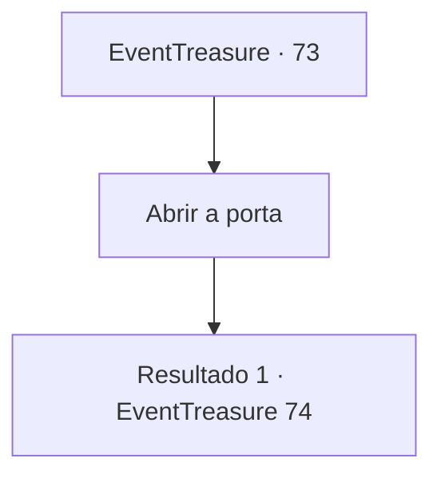

# Eventos de tesouro · 73

[Índice da tabela](index.md) · [Índice geral](../index.md)

ID: `pt:EventTreasure:73` · Fonte: `EventTreasure4` · Versão: 1.2.47.

Mapeamento estático dos arquivos; a disponibilidade e a execução dependem do estado da run.

## Texto do evento

*Sem texto no arquivo.*

## Dados de entrada

```json
{
  "id": 73,
  "grade": 1,
  "place": "",
  "required": ""
}
```

## Mapa das escolhas



## Escolhas e resultados

### Escolha 1

Abrir a porta

Requisitos e outros campos da escolha:

```json
{
  "required": ""
}
```

#### Resultado 1.1

Quando você abre a porta, o cheiro de incenso queimado e uma voz grave o cumprimentam.  

 "Bem-vindo meu amigo. É a sua primeira visita? Já nos conhecemos? Bem, isso não importa. Ah, por favor, tire os sapatos antes de entrar."

  No meio da sala vazia há um pequeno braseiro e ao lado dele está um homem que parece ser o proprietário.  O dono desta cabana bizarra tem uma aparência algo entre um humano e um lagarto.  Sua pele está coberta de escamas e alguns fios de barba azul permanecem no final de seu queixo invulgarmente longo e protuberante.  Ele tem várias cicatrizes no corpo. A maior delas passa pelo olho esquerdo, que está totalmente fechado e sem vida, provavelmente devido à cicatriz.  

 "Estranho, o fogo está um pouco fraco hoje. Não está um pouco frio?"

  Quando ele levanta o braço esquerdo e vasculha o braseiro, uma chama azul clara surge e desaparece.  O cheiro que você sentiu quando entrou na sala enche a sala.  Quando ele abaixa o metal, sua manga direita, caída pela falta de seu braço direito, atrai sua atenção.  

 "A adaga branca me chamou. Vou avaliar se você quiser. Para trazer à tona seu verdadeiro poder. Mas..."

  Ele faz uma pausa por um momento e então abre a boca novamente.  

 "... pode falhar."


Continuação registrada: [Evento 74](0074.md) na mesma tabela.

```json
{
  "required": "",
  "chance": "1",
  "nextEvent": 74,
  "type": 2,
  "reward": ""
}
```

## Referências que chegam a este evento

- [Evento 72 · escolha 1 · resultado 1](0072.md#escolha-1)
- [Evento 72 · escolha 2 · resultado 1](0072.md#escolha-2)
