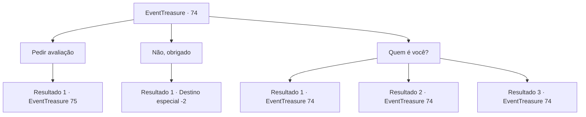

# Eventos de tesouro · 74

[Índice da tabela](index.md) · [Índice geral](../index.md)

ID: `pt:EventTreasure:74` · Fonte: `EventTreasure4` · Versão: 1.2.47.

Mapeamento estático dos arquivos; a disponibilidade e a execução dependem do estado da run.

## Texto do evento

*Sem texto no arquivo.*

## Dados de entrada

```json
{
  "id": 74,
  "grade": 1,
  "place": "",
  "required": ""
}
```

## Mapa das escolhas



## Escolhas e resultados

### Escolha 1

Pedir avaliação 

Requisitos e outros campos da escolha:

```json
{
  "required": "8_92_1"
}
```

#### Resultado 1.1

O avaliador de aparência estranha dá uma olhada na arma e fala. 

 "Carnwennan. A Adaga do Cavaleiro Rei. Mas o proprietário original não era o Cavaleiro Rei. Seu proprietário original era o Ferreiro Rei Numelmore. Ele era o rei de uma orgulhosa tribo de guerreiros. Ele procurou a arma perfeita que serviria a ele, o maior guerreiro, e no final decidiu forjar uma para si mesmo. Então, ele convidou e atendeu ferreiros e feiticeiros famosos de todo o mundo, até mesmo sequestrando e ameaçando alguns deles, aprendendo as habilidades necessárias."

 Enquanto ele vasculha o braseiro, faíscas aparecem e o cheiro sobe novamente. 

 "A arma completa, como você pode ver, é definitivamente ótima. O rei se gabou de sua nova arma, desafiando a todos. Claro, o rei não tinha dúvidas sobre sua vitória. Mas esse foi o seu erro. Enquanto ele estava se tornando um ferreiro de primeira linha, ele estava se tornando cada vez mais fraco como guerreiro. A lealdade de seus seguidores diminuiu e ele foi desafiado por muitos cavaleiros que buscavam conquistar o trono. E eventualmente ele encontrou seu fim."

 Ele puxa algo que parece um pedaço de madeira amarela dos bolsos e joga no fogo. Um fogo azul acende e o perfume sutil se torna mais claro. Seu rosto cheio de cicatrizes agora tem um sorriso satisfatório. 

 "A adaga passou por inúmeras trocas de dono em meio à luta dos gananciosos, e já se esqueceu de quem foi o primeiro dono."

 Tendo terminado suas palavras, ele joga a adaga no fogo, dizendo para você esperar um pouco.

Continuação registrada: [Evento 75](0075.md) na mesma tabela.

```json
{
  "required": "",
  "chance": "1",
  "nextEvent": 75,
  "type": 2,
  "reward": "4_92_1"
}
```

### Escolha 2

Não, obrigado

Requisitos e outros campos da escolha:

```json
{
  "required": ""
}
```

#### Resultado 2.1

Você não quer correr o risco e diz a ele que o serviço dele não será necessário. Ele acena com a cabeça e apaga o fogo. 

 "Eu vejo. Essa também é sua escolha. Te vejo outra hora. Se nossos caminhos se cruzarem novamente."

 Assim que ele termina, a escuridão o envolve. Depois de fechar e abrir os olhos, você está de alguma forma no lugar que estava antes. Foi um momento de sonho.

Continuação registrada: [Destino especial `-2`](../destinos-especiais.md).

```json
{
  "required": "",
  "chance": "1",
  "nextEvent": -2,
  "type": 2,
  "reward": "5_111_1"
}
```

### Escolha 3

Quem é você?

Requisitos e outros campos da escolha:

```json
{
  "required": "5_112_0"
}
```

#### Resultado 3.1

Você o questiona sobre a identidade dele. 

 "Você quer ouvir sobre este recluso? Huhuh, não vejo como minhas histórias ajudarão você."

 Ao contrário do que diz, o avaliador sorri. Cheio de cicatrizes e com dentes afiados aparecendo na boca enrolada em um sorriso, seu rosto causa terror, mas dá para ver claramente que ele está feliz. 

 "Deixe-me ver ... vou lhe dizer por que estou fazendo um trabalho de avaliação neste lugar. Para mim, é puramente para me divertir."

 Seu rosto fica sério por um breve momento e continua falando com uma pequena risada. 

 "Hahaha, para mim, que não faz nada além de caminhar no escuro e matar o tempo queimando incenso, andarilhos são hóspedes queridos. É muito divertido contar histórias sobre as coisas que eles têm. Embora as histórias sejam tão antigas agora que minhas memórias se tornaram embaçadas."

 Depois que ele termina, ele volta seu olhar para o braseiro.

Continuação registrada: [Evento 74](0074.md) na mesma tabela.

```json
{
  "required": "",
  "chance": "1",
  "nextEvent": 74,
  "type": 2,
  "reward": "5_112_1"
}
```

#### Resultado 3.2

Você o questiona sobre a identidade dele. Ele pensa por um breve momento antes de abrir a boca. 

 "Que tal uma história sobre o incenso desta vez? Lembro-me de quando conheci esse perfume ... era o mais profundo do tenebroso abismo. Era um lugar que se chamaria de fim do mundo, onde as coisas vão afundar, desaparecer. Lá cresce uma criatura conhecida por desintegrar todos os tipos de coisas, e quando chega ao fim de sua vida, torna-se um fragmento como este."

 Ele puxa algo que parece um pedaço de madeira amarela dos bolsos e joga no fogo. Um fogo azul acende e o perfume sutil se torna mais claro. Seu rosto cheio de cicatrizes agora tem um sorriso satisfatório novamente.

Continuação registrada: [Evento 74](0074.md) na mesma tabela.

```json
{
  "required": "",
  "chance": "1",
  "nextEvent": 74,
  "type": 2,
  "reward": "5_112_1"
}
```

#### Resultado 3.3

Você o questiona sobre a identidade dele.  Ele responde, balançando a cabeça lentamente.  

 "Eu sou apenas um homem que puxa as histórias armazenadas em armas. Quando foco meus ouvidos assim, posso ouvir a voz que me chama.  A voz quer ser reconhecida. Então, posso trazê-lo com um pouco mais de esforço."

  Você acha que a cabeça de lagarto dele nem mesmo tem uma orelha, mas deixa ele fazer isso.

Continuação registrada: [Evento 74](0074.md) na mesma tabela.

```json
{
  "required": "",
  "chance": "1",
  "nextEvent": 74,
  "type": 2,
  "reward": "5_112_1"
}
```

## Referências que chegam a este evento

- [Evento 73 · escolha 1 · resultado 1](0073.md#escolha-1)
- [Evento 74 · escolha 3 · resultado 1](0074.md#escolha-3)
- [Evento 74 · escolha 3 · resultado 2](0074.md#escolha-3)
- [Evento 74 · escolha 3 · resultado 3](0074.md#escolha-3)
