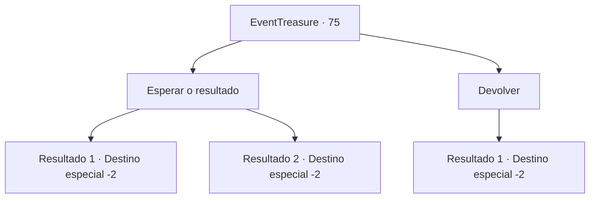

# Eventos de tesouro · 75

[Índice da tabela](index.md) · [Índice geral](../index.md)

ID: `pt:EventTreasure:75` · Fonte: `EventTreasure4` · Versão: 1.2.47.

Mapeamento estático dos arquivos; a disponibilidade e a execução dependem do estado da run.

## Texto do evento

*Sem texto no arquivo.*

## Dados de entrada

```json
{
  "id": 75,
  "grade": 1,
  "place": "",
  "required": ""
}
```

## Mapa das escolhas



## Escolhas e resultados

### Escolha 1

Esperar o resultado

Requisitos e outros campos da escolha:

```json
{
  "required": ""
}
```

#### Resultado 1.1

Ele coloca a adaga azulada aquecida em suas mãos.  Você fica assustado, mas não sente nenhum calor. Logo, a arma emite uma luz branca de sua mão.  Ele olha para a figura com um olhar exultante no rosto e fala.  

 "Parece que o relacionamento entre você e Carnwennan vai continuar. Te vejo outra hora. Se nossos caminhos se cruzarem novamente."

  Assim que ele termina, a escuridão o envolve.  Depois de fechar e abrir os olhos, você está de alguma forma no lugar que estava antes.  A única evidência que prova que o que acabou de acontecer não foi um sonho, é a adaga em suas mãos.

Continuação registrada: [Destino especial `-2`](../destinos-especiais.md).

```json
{
  "required": "",
  "chance": "1|0_6_1",
  "nextEvent": -2,
  "type": 0,
  "reward": "3_149_1|5_111_1"
}
```

#### Resultado 1.2

Ele põe a adaga, aquecida em azul, em suas mãos.  Você fica assustado, mas não sente nenhum calor. Logo, a arma se transforma em cinzas em suas mãos.  

 "Isso é lamentável. Este é apenas um de muitos destinos, por isso não se decepcione. Vejo você de novo amigo, nossos caminhos devem se cruzar novamente."

  Assim que ele termina, a escuridão o envolve.  Depois de fechar e abrir os olhos, você está de alguma forma no lugar que estava antes.  A única evidência que prova que o que acabou de acontecer não foi um sonho, é o punhado de cinzas na sua mão.

Continuação registrada: [Destino especial `-2`](../destinos-especiais.md).

```json
{
  "required": "",
  "chance": "12",
  "nextEvent": -2,
  "type": 1,
  "reward": "5_111_1"
}
```

### Escolha 2

Devolver

Requisitos e outros campos da escolha:

```json
{
  "required": ""
}
```

#### Resultado 2.1

Você pede a ele para puxar a adaga do fogo.  Ele concorda com a cabeça e apaga o fogo.  

 "Eu vejo. Essa também é sua escolha. Te vejo outra hora. Se nossos caminhos se cruzarem novamente."

  Assim que ele termina, a escuridão o envolve.  Depois de fechar e abrir os olhos, você está de alguma forma no lugar que estava antes.  Foi um momento de sonho.

Continuação registrada: [Destino especial `-2`](../destinos-especiais.md).

```json
{
  "required": "",
  "chance": "1",
  "nextEvent": -2,
  "type": 2,
  "reward": "5_111_1|3_92_1"
}
```

## Referências que chegam a este evento

- [Evento 74 · escolha 1 · resultado 1](0074.md#escolha-1)
