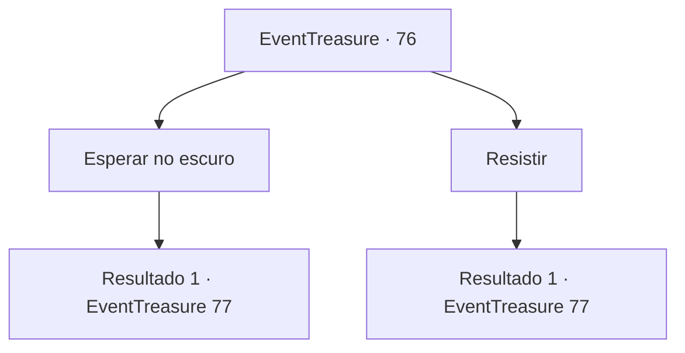

# Eventos de tesouro · 76

[Índice da tabela](index.md) · [Índice geral](../index.md)

ID: `pt:EventTreasure:76` · Fonte: `EventTreasure4` · Versão: 1.2.47.

Mapeamento estático dos arquivos; a disponibilidade e a execução dependem do estado da run.

## Texto do evento

Ao andar pelas ruas, como de costume, você sente uma repentina premonição. Seu corpo fica frio, e você sente seus pêlos arrepiarem. Assim que você sente como se seu corpo inteiro sentisse câimbras, o espaço em que você está dá uma leve estremecida. As pedras no chão parecem flutuar no ar, como se cedessem à vibração, e de repente tudo escurece. Você parece flutuar no vazio, no escuro absoluto, nenhuma estrela sequer à vista.

## Dados de entrada

```json
{
  "id": 76,
  "grade": 2,
  "place": "",
  "required": "8_80_1|5_111_0"
}
```

## Mapa das escolhas



## Escolhas e resultados

### Escolha 1

Esperar no escuro

Requisitos e outros campos da escolha:

```json
{
  "required": ""
}
```

#### Resultado 1.1

Você fica parado e espera seus sentidos se ajustarem. Após algum tempo - que você não consegue decidir se foi uma eternidade ou um instante - passar, você percebe que suas duas pernas estão em pé no chão. Ainda está escuro em todo lugar, mas você um vislumbre de luz perante você, e segue para lá. É uma casinha feita de madeira e pedra que dá um sutil brilho na escuridão extrema.

Continuação registrada: [Evento 77](0077.md) na mesma tabela.

```json
{
  "required": "",
  "chance": "1",
  "nextEvent": 77,
  "type": 2,
  "reward": ""
}
```

### Escolha 2

Resistir

Requisitos e outros campos da escolha:

```json
{
  "required": ""
}
```

#### Resultado 2.1

Você debate seus braços e pernas. E de repente você percebe que suar duas pernas estão em pé no chão. Ainda está escuro em todo lugar, mas você vê um vislumbre de luz perante você, e segue para lá. É uma casinha feita de madeira e pedra que dá um sutil brilho na escuridão extrema.

Continuação registrada: [Evento 77](0077.md) na mesma tabela.

```json
{
  "required": "",
  "chance": "1",
  "nextEvent": 77,
  "type": 2,
  "reward": ""
}
```

## Referências que chegam a este evento

Nenhum `nextEvent` positivo da mesma tabela aponta para este nó. Isso não prova que seja inacessível: sorteio e estado de história podem selecioná-lo.

