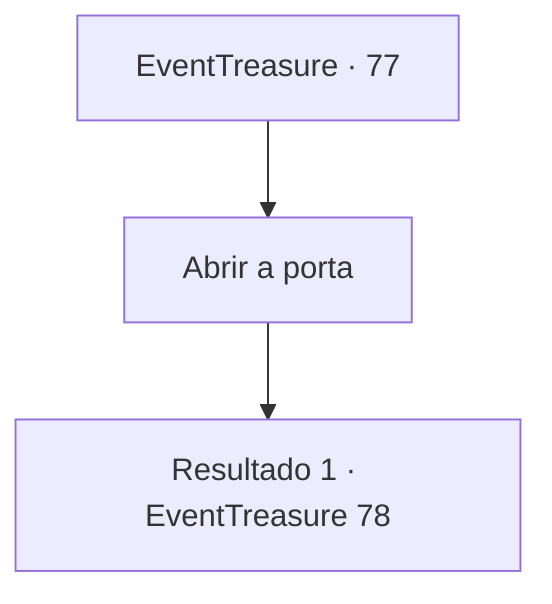

# Eventos de tesouro · 77

[Índice da tabela](index.md) · [Índice geral](../index.md)

ID: `pt:EventTreasure:77` · Fonte: `EventTreasure4` · Versão: 1.2.47.

Mapeamento estático dos arquivos; a disponibilidade e a execução dependem do estado da run.

## Texto do evento

*Sem texto no arquivo.*

## Dados de entrada

```json
{
  "id": 77,
  "grade": 1,
  "place": "",
  "required": ""
}
```

## Mapa das escolhas



## Escolhas e resultados

### Escolha 1

Abrir a porta

Requisitos e outros campos da escolha:

```json
{
  "required": ""
}
```

#### Resultado 1.1

Quando você abre a porta, o cheiro de incenso queimando e uma voz grave te cumprimenta. 

 "Bem-vindo, meu amigo. Essa é sua primeira visita? Já nos conhecemos? Bem, não importa. Ah, por favor tire os sapatos antes de entrar."

 No meio da sala vazia há um pequeno braseiro, e próximo está sentado um homem que parece ser o dono. O dono dessa cabana bizarra tem uma aparência que é algo entre humano e lagarto. A pele dela é coberta com escamas, e alguns tufos de barba azul permanem na ponta de seu estranhamente longo, e saliente queixo. Ele possui muitas cicatrizes no corpo. A mais longa passa por seu olho esquerdo, que fica totalmente fechado e cego, provavelmente por conta da cicatriz. 

 "Estranho, o fogo está um pouco fraco hoje. Não está um pouco frio?"

 Enquanto ele levanta o braço esquerdo e atiça o braseiro, uma chama azul se ergue e desaparece. O aroma que você sentiu quando entrou toma conta da sala. Quando ele abaixa o atiçador , a manga direita, pendendo pela ausência do braço direito, chama tua atenção. 

 "Esse seu arco me chamou. Eu vou avaliar se você quiser. Pra despertar seu verdadeiro poder. Mas..."

 Ele pausa por um momento e então abre a boca novamente. 

 "... pode falhar."


Continuação registrada: [Evento 78](0078.md) na mesma tabela.

```json
{
  "required": "",
  "chance": "1",
  "nextEvent": 78,
  "type": 2,
  "reward": ""
}
```

## Referências que chegam a este evento

- [Evento 76 · escolha 1 · resultado 1](0076.md#escolha-1)
- [Evento 76 · escolha 2 · resultado 1](0076.md#escolha-2)
