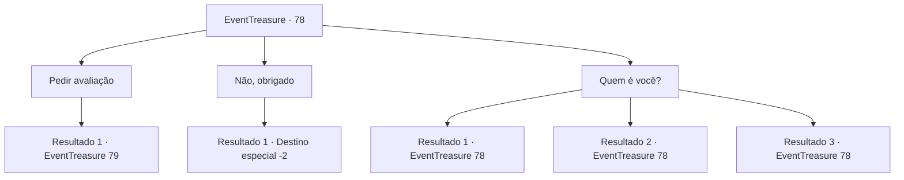

# Eventos de tesouro · 78

[Índice da tabela](index.md) · [Índice geral](../index.md)

ID: `pt:EventTreasure:78` · Fonte: `EventTreasure4` · Versão: 1.2.47.

Mapeamento estático dos arquivos; a disponibilidade e a execução dependem do estado da run.

## Texto do evento

*Sem texto no arquivo.*

## Dados de entrada

```json
{
  "id": 78,
  "grade": 1,
  "place": "",
  "required": ""
}
```

## Mapa das escolhas



## Escolhas e resultados

### Escolha 1

Pedir avaliação

Requisitos e outros campos da escolha:

```json
{
  "required": "8_80_1"
}
```

#### Resultado 1.1

O avaliador de aparência estranha olha de perto a arma, e fala. 

 "Hmmm... esse é o arco com aquele exagero Oriental, dito que pesa 1000 libras. É uma arma bem pesado, mas é muito mais que apenas isso."

 Enquanto ele atiça o braseiro, faíscas saltam, e o aroma surge de novo. 

 "Há muito tempo, houve uma guerra travada pelos divindades. Era um campo de batalha onde heróis foram quebrados como galhos secos, e imagens lendárias eram esculpidas ao ponto de desaparecer. Eu lembro de ter visto esse arco no campo de batalha. O dono dessa arma, apesar do aperto em que ele estava, lutou corajosamente em meio aos corpos de seus companheiros."

 Ele saca do bolso algo que parece um pedaço de madeira amarela, e joga no fogo. Uma chama azul estrala, e o aroma sutil fica mais evidente. O rosto cicatrizado agora tem um sorriso satisfatório. 

 "Ele eventualmente encontrou sua morte, e a divindade que ele venerava perdeu a guerra... mas ele e sua arma levaram adiante os desejos de tomas as almas perdidas. Agora, para despertar o arco..."

 Após terminar, ele atira o arco ao fogo, te dizendo para esperar um pouco.

Continuação registrada: [Evento 79](0079.md) na mesma tabela.

```json
{
  "required": "",
  "chance": "1",
  "nextEvent": 79,
  "type": 2,
  "reward": "4_80_1"
}
```

### Escolha 2

Não, obrigado

Requisitos e outros campos da escolha:

```json
{
  "required": ""
}
```

#### Resultado 2.1

Você não quer correr o risco, e o fala que os serviços dele não serão necessários. Ele acena com a cabeça, então apaga o fogo. 

 "Entendo. Essa, também, é sua decisão. Vejo você alguma outra vez. Se nossos caminhos se cruzarem novamente."

 Assim que ele termina, a escuridão te cerca. Após fechar e abrir os olhos, de algum modo você voltou ao lugar de antes. Tudo pareceu um sonho.

Continuação registrada: [Destino especial `-2`](../destinos-especiais.md).

```json
{
  "required": "",
  "chance": "1",
  "nextEvent": -2,
  "type": 2,
  "reward": "5_111_1"
}
```

### Escolha 3

Quem é você?

Requisitos e outros campos da escolha:

```json
{
  "required": "5_112_0"
}
```

#### Resultado 3.1

Você o questiona sobre sua identidade. 

 "Você quer escutar esse recluso? Huhuh, eu não sei como minhas histórias vão te ajudar."

 Contrário ao que ele diz, o avaliador sorri. Cheio de cicatrizes e seus dentes afiados aparecendo em sua boca sorridente, o rosto dele indica terror, mas você claramente vê que ele está feliz. 

 "Deixe-me ver... eu vou te contar o porque de eu fazer esse trabalho de avalia nesse lugar. Para mim, é puramente por diversão."

 Ele fica com a feição séria por pouco tempo, e continua falando com um pequeno sorriso. 

 "Hahaha, para mim, que não faço nada a não ser caminhar no escuro e matar o tempo queimando incenso, andarilhos são queridos convidados. É bem divertido contar histórias sobre coisas que eles tem. Embora as histórias estejam tão velhas agora que minha memória ficou embaçada."

 Após terminar, ele volta a olhar para o braseiro.

Continuação registrada: [Evento 78](0078.md) na mesma tabela.

```json
{
  "required": "",
  "chance": "1",
  "nextEvent": 78,
  "type": 2,
  "reward": "5_112_1"
}
```

#### Resultado 3.2

Você o questiona sobre sua identidade. Ele pensa por um breve momento antes de abrir a boca. 

 "Que tal uma história sobre esse incenso dessa vez? Eu lembro a primeira vez que eu senti esse aroma... era o mais profundo e tenebroso abismo. Era um lugar que se podia chamar de fim do mundo, onde coisas iam para afundar, desaparecer. Lá fica uma criatura conhecida por desintegrar todo tipo de coisa, e quando ela chega no fim da vida, se transforma num fragmento que nem esse."

 Ele saca do bolso algo que parece um pedaço de madeira amarela, e joga no fogo. Uma chama azul estrala, e o aroma sutil fica mais evidente. seu rosto cicatrizado agora tem um sorriso satisfatório novamente.

Continuação registrada: [Evento 78](0078.md) na mesma tabela.

```json
{
  "required": "",
  "chance": "1",
  "nextEvent": 78,
  "type": 2,
  "reward": "5_112_1"
}
```

#### Resultado 3.3

Você o questiona sobre sua identidade. Ele responde, acendo a cabeça lentamente. 

 "Sou apenas um homem que extrai histórias dos itens. Quando eu foco minhas orelhas assim. Posso ouvir uma voz me chamado. Ela quer ser reconhecida. Então eu consigo botá-la para fora com um pouco mais de esforço."

 Você acha que a cabeça de lagarto dele nem tem orelhas, mas decide ver no que isso vai dar.

Continuação registrada: [Evento 78](0078.md) na mesma tabela.

```json
{
  "required": "",
  "chance": "1",
  "nextEvent": 78,
  "type": 2,
  "reward": "5_112_1"
}
```

## Referências que chegam a este evento

- [Evento 77 · escolha 1 · resultado 1](0077.md#escolha-1)
- [Evento 78 · escolha 3 · resultado 1](0078.md#escolha-3)
- [Evento 78 · escolha 3 · resultado 2](0078.md#escolha-3)
- [Evento 78 · escolha 3 · resultado 3](0078.md#escolha-3)
