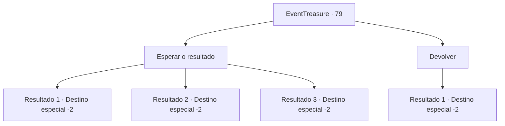

# Eventos de tesouro · 79

[Índice da tabela](index.md) · [Índice geral](../index.md)

ID: `pt:EventTreasure:79` · Fonte: `EventTreasure4` · Versão: 1.2.47.

Mapeamento estático dos arquivos; a disponibilidade e a execução dependem do estado da run.

## Texto do evento

*Sem texto no arquivo.*

## Dados de entrada

```json
{
  "id": 79,
  "grade": 1,
  "place": "",
  "required": ""
}
```

## Mapa das escolhas



## Escolhas e resultados

### Escolha 1

Esperar o resultado

Requisitos e outros campos da escolha:

```json
{
  "required": ""
}
```

#### Resultado 1.1

Ele coloca o arco, aquecido azul, em suas mãos. Você se assusta, mas não sente nem um pouco quente. Logo, a arma emite da sua mão uma luz branca. Ele olha a cena com um olhar contente em seu rosto e fala. 

 "Parece que a relação entre você e o Arco de Mil Libras vai continuar. Vejo você alguma outra vez. Se nossos caminhos se cruzarem novamente."

 Assim que ele termina, a escuridão te cerca. Após fechar e abrir os olhos, de algum modo você voltou ao lugar de antes. A única evidência que prova que o que aconteceu não foi um sonho, é o arco em suas mãos.

Continuação registrada: [Destino especial `-2`](../destinos-especiais.md).

```json
{
  "required": "",
  "chance": "1|0_6_1",
  "nextEvent": -2,
  "type": 0,
  "reward": "3_153_1|5_111_1"
}
```

#### Resultado 1.2

Ele coloca o arco, aquecido azul, em suas mãos. Você se assusta, mas não sente nem um pouco quente. Logo, a arma emite da sua mão uma luz branca. Ele olha a cena com um olhar contente em seu rosto e fala. 

 "Parece que a relação entre você e o Arco de Mil Libras vai continuar. Vejo você alguma outra vez. Se nossos caminhos se cruzarem novamente."

 Assim que ele termina, a escuridão te cerca. Após fechar e abrir os olhos, de algum modo você voltou ao lugar de antes. A única evidência que prova que o que aconteceu não foi um sonho, é o arco em suas mãos.

Continuação registrada: [Destino especial `-2`](../destinos-especiais.md).

```json
{
  "required": "",
  "chance": "1|0_5_1",
  "nextEvent": -2,
  "type": 0,
  "reward": "3_153_1|5_111_1"
}
```

#### Resultado 1.3

Ele coloca o arco, aquecido azul, em suas mãos. Você se assusta, mas não sente nem um pouco quente. Logo, a arma vira cinzas em suas mãos. 

 "Que infelicidade. Esse é apenas um de muitos destinos, então não se desaponte. Te vejo de novo amigo, caso nossos caminhos se cruzem novamente."

 Assim que ele termina, a escuridão te cerca. Após fechar e abrir os olhos, de algum modo você voltou ao lugar de antes. A única evidência que prova que o que aconteceu não foi um sonho, é o punhado de cinzas em sua mão.

Continuação registrada: [Destino especial `-2`](../destinos-especiais.md).

```json
{
  "required": "",
  "chance": "30",
  "nextEvent": -2,
  "type": 1,
  "reward": "5_111_1"
}
```

### Escolha 2

Devolver

Requisitos e outros campos da escolha:

```json
{
  "required": ""
}
```

#### Resultado 2.1

Você o pede para tirar o arco do fogo. Ele acena a cabeça, e apaga o fogo. 

 "Entendo. Essa, também, é sua escolha. Vejo você alguma outra vez. Se nossos caminhos se cruzarem novamente."

 Assim que ele termina, a escuridão te cerca. Após fechar e abrir os olhos, de algum modo você voltou ao lugar de antes. Tudo pareceu um sonho.

Continuação registrada: [Destino especial `-2`](../destinos-especiais.md).

```json
{
  "required": "",
  "chance": "1",
  "nextEvent": -2,
  "type": 2,
  "reward": "5_111_1|3_80_1"
}
```

## Referências que chegam a este evento

- [Evento 78 · escolha 1 · resultado 1](0078.md#escolha-1)
