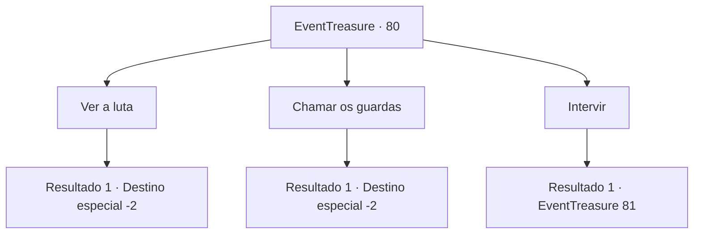

# Eventos de tesouro · 80

[Índice da tabela](index.md) · [Índice geral](../index.md)

ID: `pt:EventTreasure:80` · Fonte: `EventTreasure4` · Versão: 1.2.47.

Mapeamento estático dos arquivos; a disponibilidade e a execução dependem do estado da run.

## Texto do evento

Numa tarde chuvosa e úmida, você passeia pela cidade de 'Hanssel', olhando para o sol se pondo no céu. Naquele momento, com o barulho pesado de algo quebrando, a porta de uma taverna próxima é quebrada em pedaços. Um homem cai no chão e rola. Ele grita após limpar nas mangas o sangue de sua boca, ficando novamente em pé como se nada tivesse acontecido. 

 "Hah! Seus anões patéticos! Eu encaro todos de uma vez! Eu vou matar todos vocês!"

 Então, dois anões saem da taverna respondendo. 

 "Você fala muita merda, seu bastardo! Hoje vai ser seu funeral!"

 Com toda essa comoção, uma boa platéia se formou pra ver o que estava acontecendo.

## Dados de entrada

```json
{
  "id": 80,
  "grade": 1,
  "place": "",
  "required": "5_122_0"
}
```

## Mapa das escolhas



## Escolhas e resultados

### Escolha 1

Ver a luta

Requisitos e outros campos da escolha:

```json
{
  "required": ""
}
```

#### Resultado 1.1

Você assiste os bêbados lutarem, junto com a plateia. Eles atiram seus punhos sem acerto e rolam pelo chão, enganchados uns nos outros. Então, o anão nocauteia o humano com seu soco. 

 "Hahaha! Como ousa lutar comigo...!"

 Eles cospem no homem caído e voltam para a taverna. Após a luta terminar, os transeuntes voltam aos próprios assuntos, e você também se dirige a outro lugar.

Continuação registrada: [Destino especial `-2`](../destinos-especiais.md).

```json
{
  "required": "",
  "chance": "1",
  "nextEvent": -2,
  "type": 2,
  "reward": "5_122_9"
}
```

### Escolha 2

Chamar os guardas

Requisitos e outros campos da escolha:

```json
{
  "required": ""
}
```

#### Resultado 2.1

Você chama um dos guardas que patrulham as ruas para separar a luta dos bêbados. O guarda vai em direção ao tumulto, e puxa os bêbados para longe um do outro. 

 "Não façam birra e me sigam quietos!"

 Eles também atiram seus mãos no guarda mas são silenciados após alguns golpes de porrete. A plateia voltam resmungando aos próprios assuntos, e você também se direge a outro lugar.

Continuação registrada: [Destino especial `-2`](../destinos-especiais.md).

```json
{
  "required": "",
  "chance": "1",
  "nextEvent": -2,
  "type": 2,
  "reward": "0_3_1|5_122_9"
}
```

### Escolha 3

Intervir

Requisitos e outros campos da escolha:

```json
{
  "required": ""
}
```

#### Resultado 3.1

Você intervém entre os bêbados. Então, os rostos dos anões, já vermelhas de raiva, ficam ainda mais vermelhas. 

 "Ahn! Ok, dois contra dois então! Venham, seus filhos da p*ta!"

 Eles avançam em vocês como javalis selvagens.

Continuação registrada: [Evento 81](0081.md) na mesma tabela.

```json
{
  "required": "",
  "chance": "1",
  "nextEvent": 81,
  "type": 2,
  "reward": "6_0_87",
  "place": 4
}
```

## Referências que chegam a este evento

Nenhum `nextEvent` positivo da mesma tabela aponta para este nó. Isso não prova que seja inacessível: sorteio e estado de história podem selecioná-lo.

