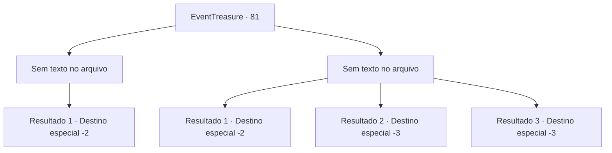

# Eventos de tesouro · 81

[Índice da tabela](index.md) · [Índice geral](../index.md)

ID: `pt:EventTreasure:81` · Fonte: `EventTreasure4` · Versão: 1.2.47.

Mapeamento estático dos arquivos; a disponibilidade e a execução dependem do estado da run.

## Texto do evento

*Sem texto no arquivo.*

## Dados de entrada

```json
{
  "id": 81,
  "grade": 1,
  "place": "",
  "required": ""
}
```

## Mapa das escolhas



## Escolhas e resultados

### Escolha 1

*Sem texto no arquivo; o papel dessa opção depende da interface do jogo.*

Requisitos e outros campos da escolha:

```json
{
  "required": ""
}
```

#### Resultado 1.1

Após a luta terminar, você é o único de pé. A plateia aplaude e torce. Então, o taverneiro sai pela porta espatifada. Ele se aproxima de você e fala, tocando ,no seu ombro. 

 "Obrigado. Eu estava preocupado com o que eu devia fazer com esses bêbados, mas você deu um jeito neles."

 Ele te entrega um pergaminho velho, dizendo que é o único símbolo de gratidão que ele tem disponível. É um mapa que mostra a localização de um tesouro. 

 "Um cliente uma vez me deu isso como pagamento pela bebida... Eu não tenho idéia que tipo de tesouro há lá, mas dizem que é muito valioso."

 Você pega o mapa velho, e continua sua aventura.

Continuação registrada: [Destino especial `-2`](../destinos-especiais.md).

```json
{
  "required": "",
  "chance": "1",
  "nextEvent": -2,
  "type": 2,
  "reward": "0_3_-1|0_2_1|0_4_5|3_157_1|5_122_1"
}
```

### Escolha 2

*Sem texto no arquivo; o papel dessa opção depende da interface do jogo.*

Requisitos e outros campos da escolha:

```json
{
  "required": ""
}
```

#### Resultado 2.1

Após a luta terminar, você cai no chão junto ao humano bêbado. A plateia aplaude e torce. 

 "Pfft! Saibam seu lugar, seus bastardos!"

 O anão, com a respiração pesada de raiva, cospe em vocês e vai embora. Você deixa o lugar ligeiramente, tentando ao máximo ignorar a plateia, segurando nos seus machucados.

Continuação registrada: [Destino especial `-2`](../destinos-especiais.md).

```json
{
  "required": "1_1_2|1_0_2",
  "chance": "1",
  "nextEvent": -2,
  "type": 2,
  "reward": "0_0_-1|0_1_-1"
}
```

#### Resultado 2.2

Após a luta terminar, você cai no chão junto ao humano bêbado. A plateia aplaude e torce. Deitado no chão, molhado de chuva, você lentamente sente sua consciência sumir.

Continuação registrada: [Destino especial `-3`](../destinos-especiais.md).

```json
{
  "required": "2_0_2",
  "chance": "1",
  "nextEvent": -3,
  "type": 2,
  "reward": "0_0_-1|0_1_-1"
}
```

#### Resultado 2.3

Após a luta terminar, você cai no chão junto ao humano bêbado. A plateia aplaude e torce. Deitado no chão, molhado de chuva, você lentamente sente sua consciência sumir.

Continuação registrada: [Destino especial `-3`](../destinos-especiais.md).

```json
{
  "required": "2_1_2",
  "chance": "1",
  "nextEvent": -3,
  "type": 2,
  "reward": "0_0_-1|0_1_-1"
}
```

## Referências que chegam a este evento

- [Evento 80 · escolha 3 · resultado 1](0080.md#escolha-3)
