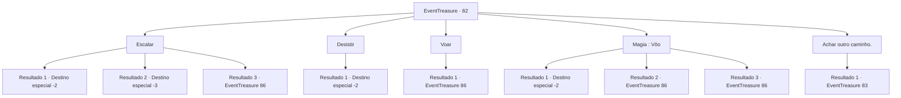

# Eventos de tesouro · 82

[Índice da tabela](index.md) · [Índice geral](../index.md)

ID: `pt:EventTreasure:82` · Fonte: `EventTreasure4` · Versão: 1.2.47.

Mapeamento estático dos arquivos; a disponibilidade e a execução dependem do estado da run.

## Texto do evento

Você segue as instruções escritas no mapa, dado pelo taverneiro de Hanssel. Finalmente, você chega no local marcado no mapa. Lá tem um penhasco de altura imensurável, e de acordo com o mapa o tesouro está escondido em algum lugar no meio do penhasco.

## Dados de entrada

```json
{
  "id": 82,
  "grade": 3,
  "place": "",
  "required": "8_157_1|5_122_1"
}
```

## Mapa das escolhas



## Escolhas e resultados

### Escolha 1

Escalar

Requisitos e outros campos da escolha:

```json
{
  "required": ""
}
```

#### Resultado 1.1

Você escala o penhasco ingreme com as próprias mãos. Mas não é capaz de chegar ao cume, e com um deslize da mão, começa a cair. 

 Depois de apagar por um tempo, você tenta se levantar, com uma dor excruciante. Você olha para o penhasco, rasga o mapa em pedaços, e se dirige à outro lugar.

Continuação registrada: [Destino especial `-2`](../destinos-especiais.md).

```json
{
  "required": "1_0_2",
  "chance": "18",
  "nextEvent": -2,
  "type": 1,
  "reward": "0_0_-1|4_157_1"
}
```

#### Resultado 1.2

Você escala o penhasco ingreme com as próprias mãos. Mas não é capaz de chegar ao cume, e com um deslize da mão, começa a cair. Com isso sua consciência desaparece meio à escuridão.

Continuação registrada: [Destino especial `-3`](../destinos-especiais.md).

```json
{
  "required": "2_0_2",
  "chance": "18",
  "nextEvent": -3,
  "type": 1,
  "reward": "0_0_-1"
}
```

#### Resultado 1.3

Você escala o penhasco ingreme com as próprias mãos. E por volta da metade do penhasco, você descobre uma pequena caverna que aparenta ser artificial, como se alguém tivesse escavado de propósito. Um humano poderia por pouco se espremer pela passagem estreita.

Continuação registrada: [Evento 86](0086.md) na mesma tabela.

```json
{
  "required": "",
  "chance": "1|0_5_1",
  "nextEvent": 86,
  "type": 0,
  "reward": ""
}
```

### Escolha 2

Desistir

Requisitos e outros campos da escolha:

```json
{
  "required": ""
}
```

#### Resultado 2.1

Você olha para o penhasco, e decide desistir do tesouro. Você pega o mapa velho, o rasga em pedaços, e se dirige à outro lugar.

Continuação registrada: [Destino especial `-2`](../destinos-especiais.md).

```json
{
  "required": "",
  "chance": "1",
  "nextEvent": -2,
  "type": 2,
  "reward": "4_157_1"
}
```

### Escolha 3

Voar

Requisitos e outros campos da escolha:

```json
{
  "required": "20_10_1"
}
```

#### Resultado 3.1

Você voa pelo ar. E por volta da metade do penhasco, você descobre uma pequena caverna que aparenta ser artificial, come se alguém tivesse escavado de propósito. Um humano poderia por pouco se espremer por pouco pela passagem estreita.

Continuação registrada: [Evento 86](0086.md) na mesma tabela.

```json
{
  "required": "",
  "chance": "1",
  "nextEvent": 86,
  "type": 2,
  "reward": ""
}
```

### Escolha 4

Magia : Vôo

Requisitos e outros campos da escolha:

```json
{
  "required": "20_0_2|1_1_2"
}
```

#### Resultado 4.1

Você voa pelo ar com um feitiço, mas não alto o suficiente. Após descer lentamente de volta ao chão, você olha para o penhasco, rasga o mapa em pedaços, e se dirige à outro lugar.

Continuação registrada: [Destino especial `-2`](../destinos-especiais.md).

```json
{
  "required": "",
  "chance": "24",
  "nextEvent": -2,
  "type": 1,
  "reward": "4_157_1|0_1_-1"
}
```

#### Resultado 4.2

Você voa pelo ar com um feitiço. E por volta da metade do penhasco, você descobre uma pequena caverna que aparenta ser artificial, come se alguém tivesse escavado de propósito. Um humano poderia por pouco se espremer pela passagem estreita.

Continuação registrada: [Evento 86](0086.md) na mesma tabela.

```json
{
  "required": "",
  "chance": "1|0_7_1",
  "nextEvent": 86,
  "type": 0,
  "reward": "0_1_-1"
}
```

#### Resultado 4.3

Você voa pelo ar com um feitiço. E por volta da metade do penhasco, você descobre uma pequena caverna que aparenta ser artificial, come se alguém tivesse escavado de propósito. Um humano poderia se espremer por pouco pela passagem estreita.

Continuação registrada: [Evento 86](0086.md) na mesma tabela.

```json
{
  "required": "",
  "chance": "1|0_12_1",
  "nextEvent": 86,
  "type": 0,
  "reward": "0_1_-1"
}
```

### Escolha 5

Achar outro caminho.

Requisitos e outros campos da escolha:

```json
{
  "required": ""
}
```

#### Resultado 5.1

Após olhar para o penhasco, você decide procurar por um caminho alternativo. Enquanto você anda pelos caminhos ingremes da montanha, você cruza com uma cobra gigante estrangulando um herbalista. m <link=shake>

 "Por favor..Por favor me salve!"

</link> O herbalista grita indefeso, e a cobra gigante está olhando para ele, chiando.

Continuação registrada: [Evento 83](0083.md) na mesma tabela.

```json
{
  "required": "",
  "chance": "1",
  "nextEvent": 83,
  "type": 2,
  "reward": ""
}
```

## Referências que chegam a este evento

Nenhum `nextEvent` positivo da mesma tabela aponta para este nó. Isso não prova que seja inacessível: sorteio e estado de história podem selecioná-lo.

