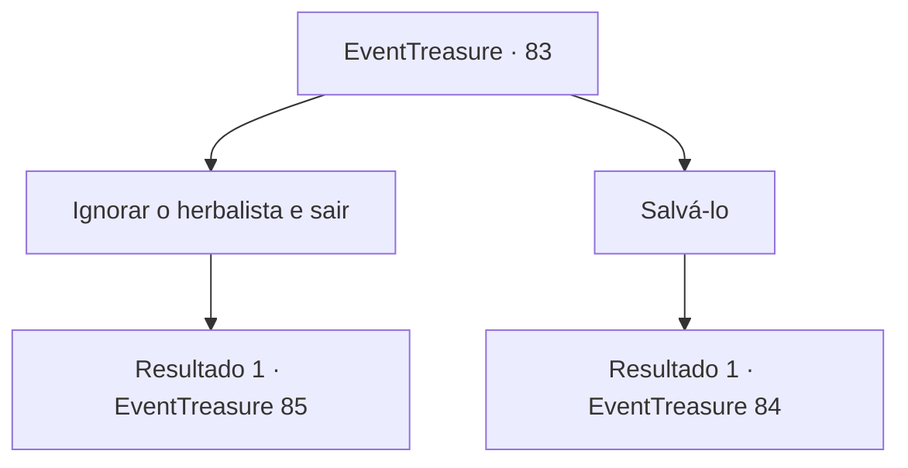

# Eventos de tesouro · 83

[Índice da tabela](index.md) · [Índice geral](../index.md)

ID: `pt:EventTreasure:83` · Fonte: `EventTreasure4` · Versão: 1.2.47.

Mapeamento estático dos arquivos; a disponibilidade e a execução dependem do estado da run.

## Texto do evento

*Sem texto no arquivo.*

## Dados de entrada

```json
{
  "id": 83,
  "grade": 1,
  "place": "",
  "required": ""
}
```

## Mapa das escolhas



## Escolhas e resultados

### Escolha 1

Ignorar o herbalista e sair

Requisitos e outros campos da escolha:

```json
{
  "required": ""
}
```

#### Resultado 1.1

Você ignora a cobra gigante estrangulando o herbalista, e segue em frente. O som de ossos quebrando ecoa, e os gritos do herbalista são silenciados dentro da boca da cobra. Sua respiração está pesada e pernas estão doloridas, mas você finalmente chega ao cume do penhasco. De acordo com o mapa, o tesouro está escondido em algum lugar no meio do penhasco, então você deve descer a fim de alcançar o tesouro.

Continuação registrada: [Evento 85](0085.md) na mesma tabela.

```json
{
  "required": "",
  "chance": "1",
  "nextEvent": 85,
  "type": 2,
  "reward": "0_3_-3"
}
```

### Escolha 2

Salvá-lo

Requisitos e outros campos da escolha:

```json
{
  "required": ""
}
```

#### Resultado 2.1

Você bate na cabeça da cobra que tenta devorar o herbalista. Isso liberta o herbalista da cobra gigante, que agora está tentando comer você ao invés do herbalista.

Continuação registrada: [Evento 84](0084.md) na mesma tabela.

```json
{
  "required": "",
  "chance": "1",
  "nextEvent": 84,
  "type": 2,
  "reward": "6_2_63",
  "place": 1
}
```

## Referências que chegam a este evento

- [Evento 82 · escolha 5 · resultado 1](0082.md#escolha-5)
