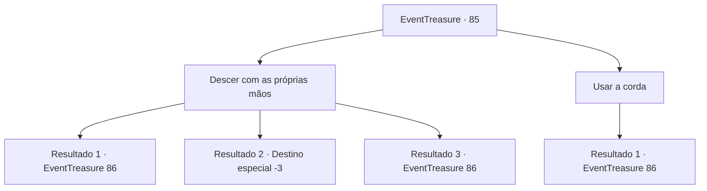

# Eventos de tesouro · 85

[Índice da tabela](index.md) · [Índice geral](../index.md)

ID: `pt:EventTreasure:85` · Fonte: `EventTreasure4` · Versão: 1.2.47.

Mapeamento estático dos arquivos; a disponibilidade e a execução dependem do estado da run.

## Texto do evento

*Sem texto no arquivo.*

## Dados de entrada

```json
{
  "id": 85,
  "grade": 1,
  "place": "",
  "required": ""
}
```

## Mapa das escolhas



## Escolhas e resultados

### Escolha 1

Descer com as próprias mãos

Requisitos e outros campos da escolha:

```json
{
  "required": ""
}
```

#### Resultado 1.1

Você checa debaixo do penhasco. A parte do meio do penhasco se destaca, e há uma caverna, escavada artificialmente. Você desce pelo penhasco cuidadosamente, mas suas mãos deslizam. Sentindo a morte, você instintivamente debate braços e pernas. Felizmente, você cai de costas numa parte saliente do penhasco. Mas você consegue se erguer novamente, aliviado por sobreviver. Um humano poderia por pouco se espremer pela passagem estreita.

Continuação registrada: [Evento 86](0086.md) na mesma tabela.

```json
{
  "required": "1_0_2",
  "chance": "11",
  "nextEvent": 86,
  "type": 1,
  "reward": "0_0_-1"
}
```

#### Resultado 1.2

Você checa debaixo do penhasco. A parte do meio do penhasco se destaca, e há uma caverna, escavada artificialmente. Você desce pelo penhasco cuidadosamente, mas suas mãos deslizam. Sentindo a morte, você instintivamente debate braços e pernas. Felizmente, você cai de costas numa parte saliente do penhasco. Com uma pancada barulhenta, você sente uma dor intensa se espalhando por seu corpo. Sua consciência desaparece meio a escuridão.

Continuação registrada: [Destino especial `-3`](../destinos-especiais.md).

```json
{
  "required": "2_0_2",
  "chance": "11",
  "nextEvent": -3,
  "type": 1,
  "reward": "0_0_-1"
}
```

#### Resultado 1.3

Você checa debaixo do penhasco. A parte do meio do penhasco se destaca, e há uma caverna, escavada artificialmente. Você consegue rastejar cuidadosamente para baixo rumo à caverna. Um humano poderia por pouco se espremer pela passagem estreita.

Continuação registrada: [Evento 86](0086.md) na mesma tabela.

```json
{
  "required": "",
  "chance": "1|0_5_1",
  "nextEvent": 86,
  "type": 0,
  "reward": ""
}
```

### Escolha 2

Usar a corda

Requisitos e outros campos da escolha:

```json
{
  "required": "8_39_1"
}
```

#### Resultado 2.1

Você checa debaixo do penhasco. A parte do meio do penhasco se destaca, e há uma caverna, escavada artificialmente. Você desce cuidadosamente pelo penhasco, mas sua mão desliza. Você amarra a corda à você e a árvore, e cuidadosamente desce o penhasco. Graças a corda, você facilmente chega à abertura da caverna. Um humano poderia por pouco se espremer pela passagem estreita.

Continuação registrada: [Evento 86](0086.md) na mesma tabela.

```json
{
  "required": "",
  "chance": "1",
  "nextEvent": 86,
  "type": 2,
  "reward": "4_39_1"
}
```

## Referências que chegam a este evento

- [Evento 83 · escolha 1 · resultado 1](0083.md#escolha-1)
- [Evento 84 · escolha 1 · resultado 1](0084.md#escolha-1)
