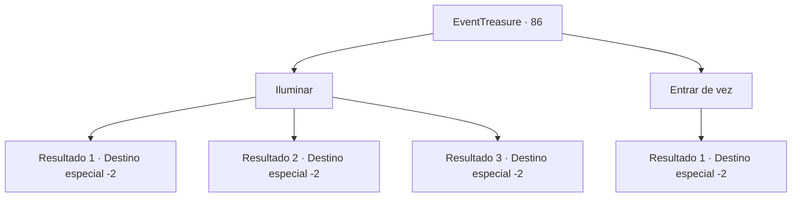

# Eventos de tesouro · 86

[Índice da tabela](index.md) · [Índice geral](../index.md)

ID: `pt:EventTreasure:86` · Fonte: `EventTreasure4` · Versão: 1.2.47.

Mapeamento estático dos arquivos; a disponibilidade e a execução dependem do estado da run.

## Texto do evento

*Sem texto no arquivo.*

## Dados de entrada

```json
{
  "id": 86,
  "grade": 1,
  "place": "",
  "required": ""
}
```

## Mapa das escolhas



## Escolhas e resultados

### Escolha 1

Iluminar

Requisitos e outros campos da escolha:

```json
{
  "required": ""
}
```

#### Resultado 1.1

Você faz uma pequena luminosidade usando mágica, e se força através da caverna estreita. Após um longo rastejo, você encontra uma chave no fim da caverna. Não havia mais nada, então você decide voltar para a taverna com a chave.

Continuação registrada: [Destino especial `-2`](../destinos-especiais.md).

```json
{
  "required": "20_0_1",
  "chance": "1",
  "nextEvent": -2,
  "type": 2,
  "reward": "3_50_1|5_122_3"
}
```

#### Resultado 1.2

Você faz uma pequena luminosidade usando a lanterna, e se força através da caverna estreita. Após um longo rastejo, você encontra uma chave no fim da caverna. Não havia mais nada, então você decide voltar para a taverna com a chave.

Continuação registrada: [Destino especial `-2`](../destinos-especiais.md).

```json
{
  "required": "23_3_1",
  "chance": "1",
  "nextEvent": -2,
  "type": 2,
  "reward": "3_50_1|5_122_3"
}
```

#### Resultado 1.3

Você não tem meios de produzir uma luz, então somente se força através da caverna estreita. Após um longo rastejo, você encontra uma chave no fim da caverna. Não havia mais nada, então você decide voltar para a taverna com a chave.

Continuação registrada: [Destino especial `-2`](../destinos-especiais.md).

```json
{
  "required": "24_3_1|21_0_1",
  "chance": "1",
  "nextEvent": -2,
  "type": 2,
  "reward": "3_50_1|5_122_3"
}
```

### Escolha 2

Entrar de vez

Requisitos e outros campos da escolha:

```json
{
  "required": ""
}
```

#### Resultado 2.1

Você se força através da escura, e estreita caverna. Após um longo rastejo, você encontra uma chave no fim da caverna. Não havia mais nada, então você decide voltar para a taverna com a chave.

Continuação registrada: [Destino especial `-2`](../destinos-especiais.md).

```json
{
  "required": "",
  "chance": "1",
  "nextEvent": -2,
  "type": 2,
  "reward": "3_50_1|5_122_3"
}
```

## Referências que chegam a este evento

- [Evento 82 · escolha 1 · resultado 3](0082.md#escolha-1)
- [Evento 82 · escolha 3 · resultado 1](0082.md#escolha-3)
- [Evento 82 · escolha 4 · resultado 2](0082.md#escolha-4)
- [Evento 82 · escolha 4 · resultado 3](0082.md#escolha-4)
- [Evento 85 · escolha 1 · resultado 1](0085.md#escolha-1)
- [Evento 85 · escolha 1 · resultado 3](0085.md#escolha-1)
- [Evento 85 · escolha 2 · resultado 1](0085.md#escolha-2)
