# Eventos de tesouro · 87

[Índice da tabela](index.md) · [Índice geral](../index.md)

ID: `pt:EventTreasure:87` · Fonte: `EventTreasure4` · Versão: 1.2.47.

Mapeamento estático dos arquivos; a disponibilidade e a execução dependem do estado da run.

## Texto do evento

Você passa na taverna de Hanssel de novo. O taverneiro lhe recebe e pergunta se você achou o tesouro. Você mostra a chave ao invés de responder e ele diz com um olhar confuso. 

 "... Essa não é a chave perdida do meu cofre?"

 Ele franze a testa por um instante, como se estivesse preocupado, e continua. 

 "Eu acho que algum 'cliente' fiel deve ter feito uma brincadeira. Eu peço mil desculpas por isso. Isso não era mesmo um tesouro."


## Dados de entrada

```json
{
  "id": 87,
  "grade": 2,
  "place": "",
  "required": "8_50_1|5_122_3"
}
```

## Mapa das escolhas

```mermaid
flowchart TD
  E["EventTreasure · 87"]
  C0["Só me dê uma bebida"]
  E --> C0
  R0_0["Resultado 1 · Destino especial -2"]
  C0 --> R0_0
  C1["Onde está esse &#x27;cliente&#x27;?"]
  E --> C1
  R1_0["Resultado 1 · EventTreasure 88"]
  C1 --> R1_0
  C2["Você só pede desculpas?"]
  E --> C2
  R2_0["Resultado 1 · Destino especial -2"]
  C2 --> R2_0
  C3["Sair da taverna"]
  E --> C3
  R3_0["Resultado 1 · Destino especial -2"]
  C3 --> R3_0
```



## Escolhas e resultados

### Escolha 1

Só me dê uma bebida

Requisitos e outros campos da escolha:

```json
{
  "required": ""
}
```

#### Resultado 1.1

Você o entrega a chave e pede ao taverneiro uma bebida. Com um olhar arrependido em seu rosto, ele traz um vinho de tom claro, dizendo que é a melhor bebida na taverna. Você bebe o picante, e refrescante vinho, e ri desse acontecimento ridículo.

Continuação registrada: [Destino especial `-2`](../destinos-especiais.md).

```json
{
  "required": "",
  "chance": "1",
  "nextEvent": -2,
  "type": 2,
  "reward": "0_3_3|0_1_1|4_50_1"
}
```

### Escolha 2

Onde está esse 'cliente'?

Requisitos e outros campos da escolha:

```json
{
  "required": ""
}
```

#### Resultado 2.1

Você o entrega a chave e pergunta ao taverneiro onde o 'cliente' está. Ele aponta ao sudeste e fala. 

 "Siga aquela direção, e na quadra com uma fonte você verá um prédio com um teto vermelho. O térreo vende sapatos, e o cliente mora no primeiro andar."

 Você vai visitar o 'cliente', como o taverneiro mencionou. Ao bater na porta do primeiro andar, um anão abre a porta um pouco e põe a cabeça para fora. Ele olha acima para você com um olhar cansado no rosto. 

 "Ahn? O quê? Quem é você?"


Continuação registrada: [Evento 88](0088.md) na mesma tabela.

```json
{
  "required": "",
  "chance": "1",
  "nextEvent": 88,
  "type": 2,
  "reward": "4_50_1"
}
```

### Escolha 3

Você só pede desculpas?

Requisitos e outros campos da escolha:

```json
{
  "required": ""
}
```

#### Resultado 3.1

Você o entrega a chave e pergunta ao taverneiro, num tom quase ameaçador. Então, com um olhar arrependido em seu rosto, ele te entrega uma bolsinha com algumas moedas de ouro. 

 "Eu sinto muito..."

 Você deixa a taverna com as desculpas do taverneiro.

Continuação registrada: [Destino especial `-2`](../destinos-especiais.md).

```json
{
  "required": "",
  "chance": "1",
  "nextEvent": -2,
  "type": 2,
  "reward": "0_4_20|4_50_1|0_2_1"
}
```

### Escolha 4

Sair da taverna

Requisitos e outros campos da escolha:

```json
{
  "required": ""
}
```

#### Resultado 4.1

Você deixa a taverna sem dizer nada.

Continuação registrada: [Destino especial `-2`](../destinos-especiais.md).

```json
{
  "required": "",
  "chance": "1",
  "nextEvent": -2,
  "type": 2,
  "reward": ""
}
```

## Referências que chegam a este evento

Nenhum `nextEvent` positivo da mesma tabela aponta para este nó. Isso não prova que seja inacessível: sorteio e estado de história podem selecioná-lo.

