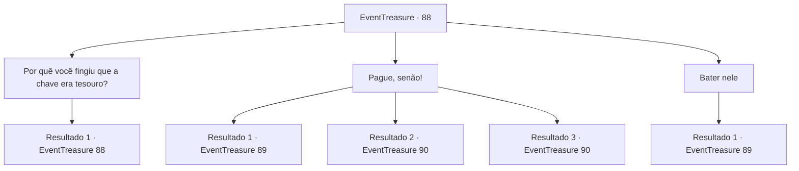

# Eventos de tesouro · 88

[Índice da tabela](index.md) · [Índice geral](../index.md)

ID: `pt:EventTreasure:88` · Fonte: `EventTreasure4` · Versão: 1.2.47.

Mapeamento estático dos arquivos; a disponibilidade e a execução dependem do estado da run.

## Texto do evento

*Sem texto no arquivo.*

## Dados de entrada

```json
{
  "id": 88,
  "grade": 1,
  "place": "",
  "required": ""
}
```

## Mapa das escolhas



## Escolhas e resultados

### Escolha 1

Por quê você fingiu que a chave era tesouro?

Requisitos e outros campos da escolha:

```json
{
  "required": "5_122_3"
}
```

#### Resultado 1.1

Ele responde sua pergunta, coçando a cabeça com vergonha. 

 "Era... era uma piada! Hehe... Você veio pela dívida em vez do taverneiro, certo? Mas agora não... Eu acho que você tem que esperar alguns dias..."


Continuação registrada: [Evento 88](0088.md) na mesma tabela.

```json
{
  "required": "",
  "chance": "1",
  "nextEvent": 88,
  "type": 2,
  "reward": "5_122_4"
}
```

### Escolha 2

Pague, senão!

Requisitos e outros campos da escolha:

```json
{
  "required": "5_122_4"
}
```

#### Resultado 2.1

Você ameaça o anão para pagar a dívida. Mas ele bufa e te empurra. 

 "Não sei que tipo de fedelho é você... mas eu sou um cliente lá! O negócio deles é totalmente dependente de mim, entendeu?"

 Então ele atira o punho em você.

Continuação registrada: [Evento 89](0089.md) na mesma tabela.

```json
{
  "required": "",
  "chance": "14",
  "nextEvent": 89,
  "type": 1,
  "reward": "6_0_87",
  "place": 4
}
```

#### Resultado 2.2

Você ameaça o anão para pagar pelo crédito. Ele fica intimidado pelo seu carisma, e te entrega uma bolsinha com algumas moedas de ouro, tremendo. 

 "Você... Você não precisa ir tão longe. Eu... Eu deveria ser um cliente..."

 Você pega o ouro e deixa a casa do anão.

Continuação registrada: [Evento 90](0090.md) na mesma tabela.

```json
{
  "required": "21_1_3",
  "chance": "1|0_12_1",
  "nextEvent": 90,
  "type": 0,
  "reward": "0_4_100|0_2_1"
}
```

#### Resultado 2.3

Você ameaça o anão para pagar pelo crédito. Ele fica intimidado pelo seu carisma, e te entrega uma bolsinha com algumas moedas de ouro, tremendo. 

 "Você... Você não precisa ir tão longe. Eu... Eu deveria ser um cliente..."

 Você pega o ouro e deixa a casa do anão.

Continuação registrada: [Evento 90](0090.md) na mesma tabela.

```json
{
  "required": "20_1_3",
  "chance": "1|0_12_2",
  "nextEvent": 90,
  "type": 0,
  "reward": "0_4_100|0_2_1"
}
```

### Escolha 3

Bater nele

Requisitos e outros campos da escolha:

```json
{
  "required": "5_122_4"
}
```

#### Resultado 3.1

Você levanta seu pé direito e chuta o anão no rosto. O corpo dele tomba para trás, e pelo som você presume que ele bateu em algo. Você abre a porta e entra na casa do anão, e o anão atira seu punho em você furiosamente.

Continuação registrada: [Evento 89](0089.md) na mesma tabela.

```json
{
  "required": "",
  "chance": "1",
  "nextEvent": 89,
  "type": 2,
  "reward": "6_2_87",
  "place": 4
}
```

## Referências que chegam a este evento

- [Evento 87 · escolha 2 · resultado 1](0087.md#escolha-2)
- [Evento 88 · escolha 1 · resultado 1](0088.md#escolha-1)
