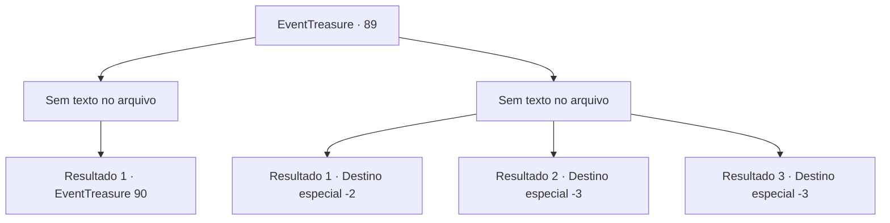

# Eventos de tesouro · 89

[Índice da tabela](index.md) · [Índice geral](../index.md)

ID: `pt:EventTreasure:89` · Fonte: `EventTreasure4` · Versão: 1.2.47.

Mapeamento estático dos arquivos; a disponibilidade e a execução dependem do estado da run.

## Texto do evento

*Sem texto no arquivo.*

## Dados de entrada

```json
{
  "id": 89,
  "grade": 1,
  "place": "",
  "required": ""
}
```

## Mapa das escolhas



## Escolhas e resultados

### Escolha 1

*Sem texto no arquivo; o papel dessa opção depende da interface do jogo.*

Requisitos e outros campos da escolha:

```json
{
  "required": ""
}
```

#### Resultado 1.1

Você ensina uma lição ao anão, e ele te entrega uma bolsa de moedas de ouro, tremendo. 

 "Eu sinto muito... Eu não vou mais fazer brincadeiras... e eu vou... pagar por minhas bebidas no prazo..."

 Ele se desculpa com você com o rosto inchado, fungando. Você pega o ouro e deixa a casa do anão.

Continuação registrada: [Evento 90](0090.md) na mesma tabela.

```json
{
  "required": "",
  "chance": "1",
  "nextEvent": 90,
  "type": 2,
  "reward": "0_4_100|0_2_1"
}
```

### Escolha 2

*Sem texto no arquivo; o papel dessa opção depende da interface do jogo.*

Requisitos e outros campos da escolha:

```json
{
  "required": ""
}
```

#### Resultado 2.1

Os socos do anão são bem mais fortes que você esperava. 

 "Saia daqui! E nunca mais volte!"

 Infelizmente, o anão te dá uma surra e te chuta para fora da casa dele.

Continuação registrada: [Destino especial `-2`](../destinos-especiais.md).

```json
{
  "required": "1_1_2|1_0_2",
  "chance": "1",
  "nextEvent": -2,
  "type": 2,
  "reward": "0_0_-1|0_1_-1"
}
```

#### Resultado 2.2

Os socos do anão são bem mais fortes do que você esperava. O punho dele te nocauteia.

Continuação registrada: [Destino especial `-3`](../destinos-especiais.md).

```json
{
  "required": "2_0_2",
  "chance": "1",
  "nextEvent": -3,
  "type": 2,
  "reward": "0_0_-1|0_1_-1"
}
```

#### Resultado 2.3

Os socos do anão são bem mais fortes do que você esperava. O punho dele te nocauteia.

Continuação registrada: [Destino especial `-3`](../destinos-especiais.md).

```json
{
  "required": "2_1_2",
  "chance": "1",
  "nextEvent": -3,
  "type": 2,
  "reward": "0_0_-1|0_1_-1"
}
```

## Referências que chegam a este evento

- [Evento 88 · escolha 2 · resultado 1](0088.md#escolha-2)
- [Evento 88 · escolha 3 · resultado 1](0088.md#escolha-3)
