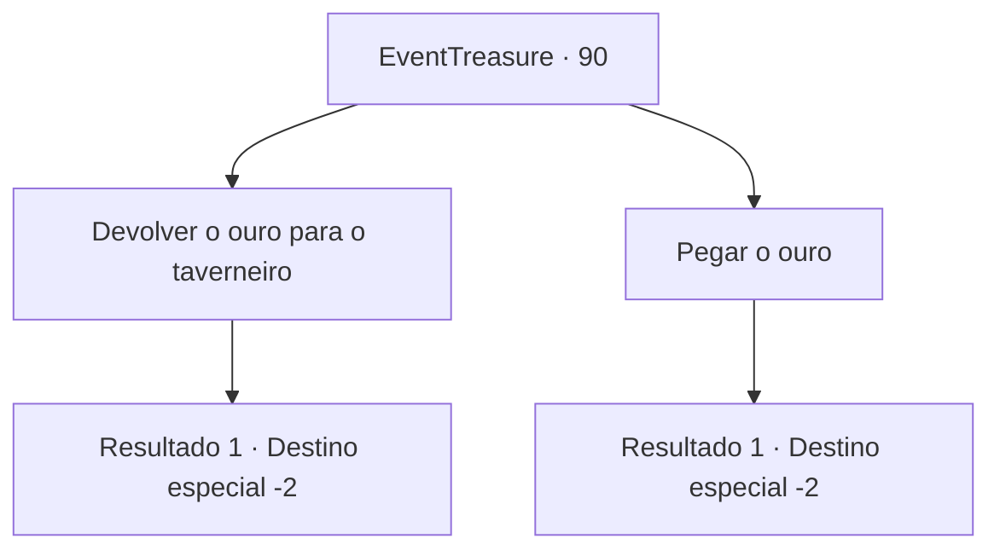

# Eventos de tesouro · 90

[Índice da tabela](index.md) · [Índice geral](../index.md)

ID: `pt:EventTreasure:90` · Fonte: `EventTreasure4` · Versão: 1.2.47.

Mapeamento estático dos arquivos; a disponibilidade e a execução dependem do estado da run.

## Texto do evento

*Sem texto no arquivo.*

## Dados de entrada

```json
{
  "id": 90,
  "grade": 1,
  "place": "",
  "required": ""
}
```

## Mapa das escolhas



## Escolhas e resultados

### Escolha 1

Devolver o ouro para o taverneiro

Requisitos e outros campos da escolha:

```json
{
  "required": ""
}
```

#### Resultado 1.1

Você entrega o ouro ao taverneiro. 

 "Oh... Isso não era mesmo necessário... mas obrigado mesmo assim, Espere um segundo."

 Ele sai por pouco tempo e volta. Em sua mão está uma rapieira prateada. 

 "Eu usava esta arma quando era um homem jovem. Eu espero que você a dê um bom uso. Boa sorte para você, então."

 Você pega a rapieira do taverneiro, e retorna à sua aventura.

Continuação registrada: [Destino especial `-2`](../destinos-especiais.md).

```json
{
  "required": "",
  "chance": "1",
  "nextEvent": -2,
  "type": 2,
  "reward": "0_4_-100|0_3_1|3_102_1|0_2_1"
}
```

### Escolha 2

Pegar o ouro

Requisitos e outros campos da escolha:

```json
{
  "required": ""
}
```

#### Resultado 2.1

Você coloca o ouro que obteve do anão em sua mochila.  E dá um passo em direção à próxima aventura.

Continuação registrada: [Destino especial `-2`](../destinos-especiais.md).

```json
{
  "required": "",
  "chance": "1",
  "nextEvent": -2,
  "type": 2,
  "reward": "5_122_5"
}
```

## Referências que chegam a este evento

- [Evento 88 · escolha 2 · resultado 2](0088.md#escolha-2)
- [Evento 88 · escolha 2 · resultado 3](0088.md#escolha-2)
- [Evento 89 · escolha 1 · resultado 1](0089.md#escolha-1)
