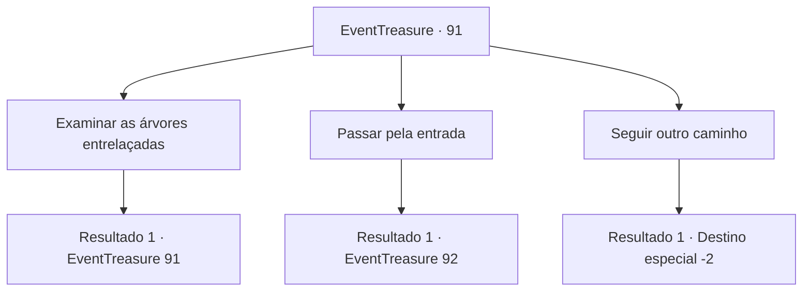

# Eventos de tesouro · 91

[Índice da tabela](index.md) · [Índice geral](../index.md)

ID: `pt:EventTreasure:91` · Fonte: `EventTreasure4` · Versão: 1.2.47.

Mapeamento estático dos arquivos; a disponibilidade e a execução dependem do estado da run.

## Texto do evento

|drawing_jungle|Você anda por uma floresta, densa com mato e árvores. E então, você encontra um bosque que passa uma sensação misteriosa. As árvores estão entrelaçadas, criando um arco - parece a entrada para um outro mundo.

## Dados de entrada

```json
{
  "id": 91,
  "grade": 1,
  "place": "",
  "required": "5_40_0"
}
```

## Mapa das escolhas



## Escolhas e resultados

### Escolha 1

Examinar as árvores entrelaçadas

Requisitos e outros campos da escolha:

```json
{
  "required": "5_40_0"
}
```

#### Resultado 1.1

  Entre as árvores entrelaçadas está uma frase gravada.  
'Dê um palpite. Meu cabelo é feito de folhas.
  Aparentemente, é um questionário sobre algo que está escondido na frente.

Continuação registrada: [Evento 91](0091.md) na mesma tabela.

```json
{
  "required": "",
  "chance": "1",
  "nextEvent": 91,
  "type": 2,
  "reward": "5_40_1"
}
```

### Escolha 2

Passar pela entrada

Requisitos e outros campos da escolha:

```json
{
  "required": ""
}
```

#### Resultado 2.1

Você é misteriosamente atraído por ele e entra na 'entrada'.  Após cerca de uma hora de caminhada, a estrada se divide em três caminhos diferentes.  Na entrada à esquerda estão as árvores de bordo.  Na entrada do meio há freixos.  Na entrada à direita estão os carvalhos.

Continuação registrada: [Evento 92](0092.md) na mesma tabela.

```json
{
  "required": "",
  "chance": "1",
  "nextEvent": 92,
  "type": 2,
  "reward": "5_40_2"
}
```

### Escolha 3

Seguir outro caminho

Requisitos e outros campos da escolha:

```json
{
  "required": ""
}
```

#### Resultado 3.1

Você ignora a entrada mística e segue por um caminho diferente.

Continuação registrada: [Destino especial `-2`](../destinos-especiais.md).

```json
{
  "required": "",
  "chance": "1",
  "nextEvent": -2,
  "type": 2,
  "reward": "5_40_9"
}
```

## Referências que chegam a este evento

- [Evento 91 · escolha 1 · resultado 1](0091.md#escolha-1)
