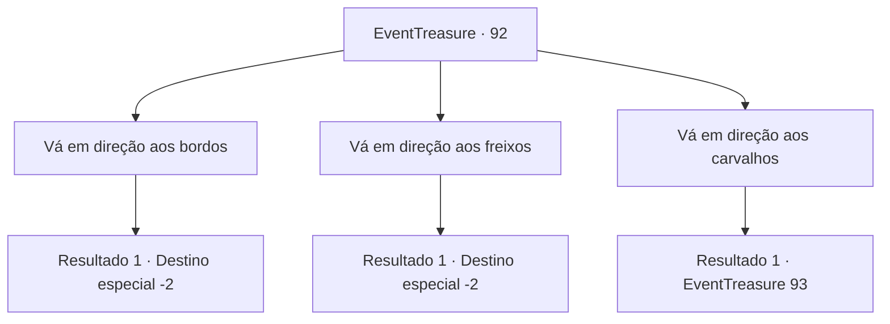

# Eventos de tesouro · 92

[Índice da tabela](index.md) · [Índice geral](../index.md)

ID: `pt:EventTreasure:92` · Fonte: `EventTreasure4` · Versão: 1.2.47.

Mapeamento estático dos arquivos; a disponibilidade e a execução dependem do estado da run.

## Texto do evento

*Sem texto no arquivo.*

## Dados de entrada

```json
{
  "id": 92,
  "grade": 1,
  "place": "",
  "required": ""
}
```

## Mapa das escolhas



## Escolhas e resultados

### Escolha 1

Vá em direção aos bordos

Requisitos e outros campos da escolha:

```json
{
  "required": ""
}
```

#### Resultado 1.1

Você dirige para a estrada com árvores de bordo.  Depois de caminhar por muito tempo, você ouve alguém dando risadinhas.  E antes que você perceba, você está fora da floresta.

Continuação registrada: [Destino especial `-2`](../destinos-especiais.md).

```json
{
  "required": "",
  "chance": "1",
  "nextEvent": -2,
  "type": 2,
  "reward": ""
}
```

### Escolha 2

Vá em direção aos freixos

Requisitos e outros campos da escolha:

```json
{
  "required": ""
}
```

#### Resultado 2.1

Você segue para a estrada com freixos.  Conforme você caminha por um longo tempo, ouve alguém rindo.  E antes que você perceba, você está fora da floresta.

Continuação registrada: [Destino especial `-2`](../destinos-especiais.md).

```json
{
  "required": "",
  "chance": "1",
  "nextEvent": -2,
  "type": 2,
  "reward": ""
}
```

### Escolha 3

Vá em direção aos carvalhos

Requisitos e outros campos da escolha:

```json
{
  "required": ""
}
```

#### Resultado 3.1

 Você segue para a estrada com carvalhos. O número de carvalhos está aumentando. Logo, as árvores de carvalho são a única coisa ao seu redor. E entre as árvores, uma senhora de cabelos frondosos e pele verde aparece. 

 "Hehe ... Prazer em conhecê-lo. Ótimo momento, eu estava entediada. Você gostaria de adivinhar um pouco mais sobre mim?"

 Ela não ouve sua resposta e lhe faz uma pergunta. 

 "Bem, em primeiro lugar, o que eu sou?"


Continuação registrada: [Evento 93](0093.md) na mesma tabela.

```json
{
  "required": "",
  "chance": "1",
  "nextEvent": 93,
  "type": 2,
  "reward": ""
}
```

## Referências que chegam a este evento

- [Evento 91 · escolha 2 · resultado 1](0091.md#escolha-2)
