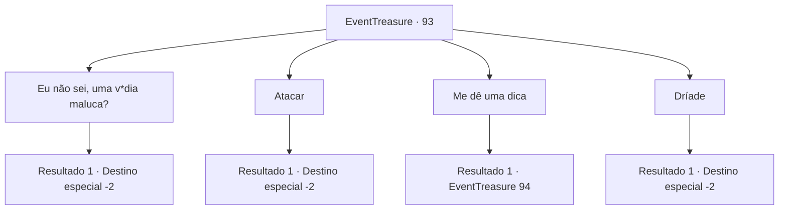

# Eventos de tesouro · 93

[Índice da tabela](index.md) · [Índice geral](../index.md)

ID: `pt:EventTreasure:93` · Fonte: `EventTreasure4` · Versão: 1.2.47.

Mapeamento estático dos arquivos; a disponibilidade e a execução dependem do estado da run.

## Texto do evento

*Sem texto no arquivo.*

## Dados de entrada

```json
{
  "id": 93,
  "grade": 1,
  "place": "",
  "required": ""
}
```

## Mapa das escolhas



## Escolhas e resultados

### Escolha 1

Eu não sei, uma v*dia maluca?

Requisitos e outros campos da escolha:

```json
{
  "required": "2_3_0"
}
```

#### Resultado 1.1

Em sua resposta direta, ela ri e ri.  

 "Errado! Qual é, eu só estava entediada. Você não está sendo muito duro comigo?"

  Em seguida, ela desaparece entre as árvores, como se estivesse se infiltrando nelas.

Continuação registrada: [Destino especial `-2`](../destinos-especiais.md).

```json
{
  "required": "",
  "chance": "1",
  "nextEvent": -2,
  "type": 2,
  "reward": "0_3_-1|0_2_1"
}
```

### Escolha 2

Atacar

Requisitos e outros campos da escolha:

```json
{
  "required": ""
}
```

#### Resultado 2.1

Você balança sua arma, mas ela já se foi.  Você só pode ouvir a voz dela.  

 "Errado! Qual é, eu só estava entediada. Você não está sendo muito duro comigo?"

  Você ignora a voz falando com você e sai da floresta.

Continuação registrada: [Destino especial `-2`](../destinos-especiais.md).

```json
{
  "required": "",
  "chance": "1",
  "nextEvent": -2,
  "type": 2,
  "reward": "0_3_-1|0_2_1"
}
```

### Escolha 3

Me dê uma dica

Requisitos e outros campos da escolha:

```json
{
  "required": ""
}
```

#### Resultado 3.1

Depois de ouvir seu pedido, a senhora olha para cima, parecendo preocupada, e logo abre a boca.  

 "Beleza. Sou uma espécie de fada. Então eu sou uma ninfa, um elfo, uma dríade ou um dragão fada, certo?"


Continuação registrada: [Evento 94](0094.md) na mesma tabela.

```json
{
  "required": "",
  "chance": "1",
  "nextEvent": 94,
  "type": 2,
  "reward": ""
}
```

### Escolha 4

Dríade

Requisitos e outros campos da escolha:

```json
{
  "required": "1_7_14"
}
```

#### Resultado 4.1

Você se lembra de sua memória que a aparência dela é semelhante à de uma 'dríade'.  A senhora bate palmas e ri da sua resposta.  

 "Hahaha! Legal. Correto! Não somos tão populares entre os humanos, mas você conseguiu acertar. Para sua recompensa ..."

  A senhora estende a mão e acaricia suavemente sua testa.  Você sente como se uma brisa suave soprasse dentro de sua cabeça.  A senhora se despede de você e desaparece na floresta, como se estivesse se infiltrando nela.

Continuação registrada: [Destino especial `-2`](../destinos-especiais.md).

```json
{
  "required": "",
  "chance": "1",
  "nextEvent": -2,
  "type": 2,
  "reward": "0_2_1|0_14_1|0_1_1|5_40_9"
}
```

## Referências que chegam a este evento

- [Evento 92 · escolha 3 · resultado 1](0092.md#escolha-3)
