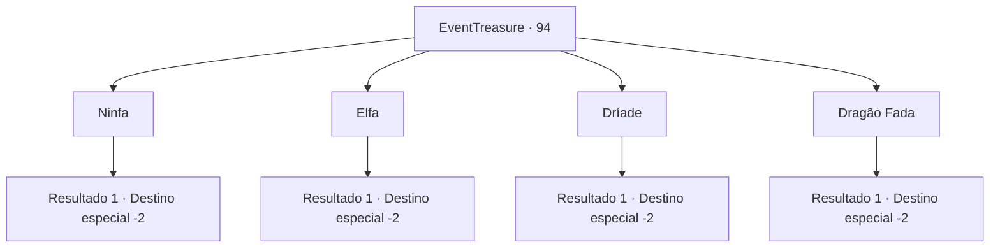

# Eventos de tesouro · 94

[Índice da tabela](index.md) · [Índice geral](../index.md)

ID: `pt:EventTreasure:94` · Fonte: `EventTreasure4` · Versão: 1.2.47.

Mapeamento estático dos arquivos; a disponibilidade e a execução dependem do estado da run.

## Texto do evento

*Sem texto no arquivo.*

## Dados de entrada

```json
{
  "id": 94,
  "grade": 1,
  "place": "",
  "required": ""
}
```

## Mapa das escolhas



## Escolhas e resultados

### Escolha 1

Ninfa

Requisitos e outros campos da escolha:

```json
{
  "required": ""
}
```

#### Resultado 1.1

Ela ri da sua resposta.  

 "Errado! Errado! Desculpe, mas outra hora ~"

  E ela se infiltra na árvore e desaparece.

Continuação registrada: [Destino especial `-2`](../destinos-especiais.md).

```json
{
  "required": "",
  "chance": "1",
  "nextEvent": -2,
  "type": 2,
  "reward": ""
}
```

### Escolha 2

Elfa

Requisitos e outros campos da escolha:

```json
{
  "required": ""
}
```

#### Resultado 2.1

Ela ri da sua resposta.  

 "Errado! Errado! Desculpe, mas outra hora ~"

  E ela se infiltra na árvore e desaparece.

Continuação registrada: [Destino especial `-2`](../destinos-especiais.md).

```json
{
  "required": "",
  "chance": "1",
  "nextEvent": -2,
  "type": 2,
  "reward": ""
}
```

### Escolha 3

Dríade

Requisitos e outros campos da escolha:

```json
{
  "required": ""
}
```

#### Resultado 3.1

A mulher bate palmas e ri da sua resposta.  

 "Hahaha! Legal. Correto! Talvez você tenha apenas dado um palpite, mas acertou de qualquer maneira e vou recompensá-lo."

  A senhora estende a mão e acaricia suavemente sua testa.  Você sente como se uma brisa suave soprasse dentro de sua cabeça.  A senhora se despede de você e desaparece na floresta, como se estivesse se infiltrando nela.

Continuação registrada: [Destino especial `-2`](../destinos-especiais.md).

```json
{
  "required": "",
  "chance": "1",
  "nextEvent": -2,
  "type": 2,
  "reward": "0_2_1|0_14_1|0_1_1|5_40_9"
}
```

### Escolha 4

Dragão Fada

Requisitos e outros campos da escolha:

```json
{
  "required": ""
}
```

#### Resultado 4.1

Ela ri da sua resposta.  

 "Errado! Desculpe, mas outra hora ~"

  E ela se infiltra na árvore e desaparece.

Continuação registrada: [Destino especial `-2`](../destinos-especiais.md).

```json
{
  "required": "",
  "chance": "1",
  "nextEvent": -2,
  "type": 2,
  "reward": ""
}
```

## Referências que chegam a este evento

- [Evento 93 · escolha 3 · resultado 1](0093.md#escolha-3)
