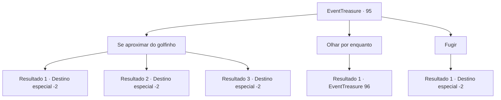

# Eventos de tesouro · 95

[Índice da tabela](index.md) · [Índice geral](../index.md)

ID: `pt:EventTreasure:95` · Fonte: `EventTreasure4` · Versão: 1.2.47.

Mapeamento estático dos arquivos; a disponibilidade e a execução dependem do estado da run.

## Texto do evento

Você anda junto à uma costa, onde presumidamente já correu lava. Então, um golfinho salta da água. Parece que vem na sua direção, nadando através das ondas.

## Dados de entrada

```json
{
  "id": 95,
  "grade": 2,
  "place": "",
  "required": "5_155_1"
}
```

## Mapa das escolhas



## Escolhas e resultados

### Escolha 1

Se aproximar do golfinho

Requisitos e outros campos da escolha:

```json
{
  "required": ""
}
```

#### Resultado 1.1

Você se aproxima do golfinho. É aquele cuja vida você salvou.  Ele se aproxima e esfrega a cabeça em você.  Em seguida, ele dá a você uma bolsa mantida na boca dele.  Quando você pega a bolsa, o golfinho gorjeia alegremente e sai nadando.

Continuação registrada: [Destino especial `-2`](../destinos-especiais.md).

```json
{
  "required": "",
  "chance": "1",
  "nextEvent": -2,
  "type": 2,
  "reward": "5_155_2|3_162_1|0_2_1"
}
```

#### Resultado 1.2

Você se aproxima do golfinho. É aquele cuja vida você salvou.  Ele se aproxima e esfrega a cabeça em você.  Em seguida, ele dá a você uma bolsa mantida na boca dele.  Quando você pega a bolsa, o golfinho gorjeia alegremente e sai nadando.

Continuação registrada: [Destino especial `-2`](../destinos-especiais.md).

```json
{
  "required": "",
  "chance": "1",
  "nextEvent": -2,
  "type": 2,
  "reward": "5_155_2|3_163_1|0_2_1"
}
```

#### Resultado 1.3

Você se aproxima do golfinho. É aquele cuja vida você salvou. Ele se aproxima e esfrega a cabeça em você. Em seguida, ele dá a você uma bolsa mantida na boca dele. Quando você pega a bolsa, o golfinho gorjeia alegremente e sai nadando.

Continuação registrada: [Destino especial `-2`](../destinos-especiais.md).

```json
{
  "required": "",
  "chance": "1",
  "nextEvent": -2,
  "type": 2,
  "reward": "5_155_2|3_125_1|0_2_1"
}
```

### Escolha 2

Olhar por enquanto

Requisitos e outros campos da escolha:

```json
{
  "required": ""
}
```

#### Resultado 2.1

Você fica parado olhando para o golfinho. Ele coloca a cabeça para fora da água, distanciado da costa e o encara de volta.  Ele está segurando uma bolsa na boca,  que põe na areia e empurra com a cabeça. Como se estivesse dizendo para você pegar.

Continuação registrada: [Evento 96](0096.md) na mesma tabela.

```json
{
  "required": "",
  "chance": "1",
  "nextEvent": 96,
  "type": 2,
  "reward": ""
}
```

### Escolha 3

Fugir

Requisitos e outros campos da escolha:

```json
{
  "required": ""
}
```

#### Resultado 3.1

De repente, você sente uma premonição e foge.

Continuação registrada: [Destino especial `-2`](../destinos-especiais.md).

```json
{
  "required": "",
  "chance": "1",
  "nextEvent": -2,
  "type": 2,
  "reward": "5_155_3"
}
```

## Referências que chegam a este evento

Nenhum `nextEvent` positivo da mesma tabela aponta para este nó. Isso não prova que seja inacessível: sorteio e estado de história podem selecioná-lo.

