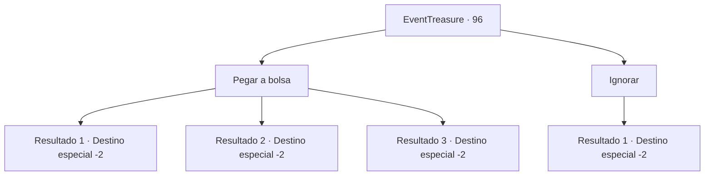

# Eventos de tesouro · 96

[Índice da tabela](index.md) · [Índice geral](../index.md)

ID: `pt:EventTreasure:96` · Fonte: `EventTreasure4` · Versão: 1.2.47.

Mapeamento estático dos arquivos; a disponibilidade e a execução dependem do estado da run.

## Texto do evento

*Sem texto no arquivo.*

## Dados de entrada

```json
{
  "id": 96,
  "grade": 1,
  "place": "",
  "required": ""
}
```

## Mapa das escolhas



## Escolhas e resultados

### Escolha 1

Pegar a bolsa

Requisitos e outros campos da escolha:

```json
{
  "required": ""
}
```

#### Resultado 1.1

Você tira a bolsa do golfinho da água do mar,  e o golfinho gorjeia alegremente e sai nadando.

Continuação registrada: [Destino especial `-2`](../destinos-especiais.md).

```json
{
  "required": "",
  "chance": "1",
  "nextEvent": -2,
  "type": 2,
  "reward": "5_155_2|3_162_1|0_2_1"
}
```

#### Resultado 1.2

Você tira a bolsa do golfinho da água do mar,  e o golfinho gorjeia alegremente e sai nadando.

Continuação registrada: [Destino especial `-2`](../destinos-especiais.md).

```json
{
  "required": "",
  "chance": "1",
  "nextEvent": -2,
  "type": 2,
  "reward": "5_155_2|3_163_1|0_2_1"
}
```

#### Resultado 1.3

Você tira a bolsa do golfinho da água do mar,  e o golfinho gorjeia alegremente e sai nadando.

Continuação registrada: [Destino especial `-2`](../destinos-especiais.md).

```json
{
  "required": "",
  "chance": "1",
  "nextEvent": -2,
  "type": 2,
  "reward": "5_155_2|3_125_1|0_2_1"
}
```

### Escolha 2

Ignorar

Requisitos e outros campos da escolha:

```json
{
  "required": ""
}
```

#### Resultado 2.1

Você ignora a bolsa do golfinho.  Ele inclina a cabeça algumas vezes e retorna ao mar distante.

Continuação registrada: [Destino especial `-2`](../destinos-especiais.md).

```json
{
  "required": "",
  "chance": "1",
  "nextEvent": -2,
  "type": 2,
  "reward": "5_155_3"
}
```

## Referências que chegam a este evento

- [Evento 95 · escolha 2 · resultado 1](0095.md#escolha-2)
