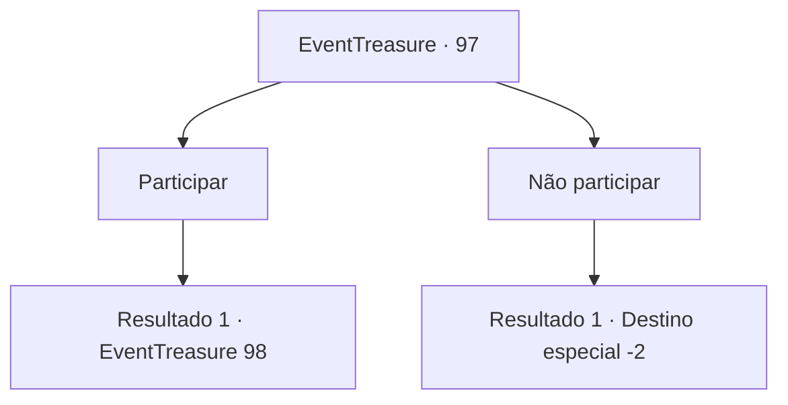

# Eventos de tesouro · 97

[Índice da tabela](index.md) · [Índice geral](../index.md)

ID: `pt:EventTreasure:97` · Fonte: `EventTreasure4` · Versão: 1.2.47.

Mapeamento estático dos arquivos; a disponibilidade e a execução dependem do estado da run.

## Texto do evento

Em meio às vastas planícies, você encontra uma pessoa misteriosa, que propõe a você entrar em uma masmorra. Além do fato do corpo inteiro dele estar vestido com um manto negro, não dá para saber a idade dele, de que raça é, ou mesmo se é um homem ou uma mulher. 

 "Este aqui é um labirinto. Você gostaria de emprestar seu corpo para as travessuras das divindades? No final do labirinto há de tudo, como glória e vergonha, vida e morte, até mesmo oportunidade e desespero."

 Ele aponta para a entrada escura com os dedos depois de terminar.

## Dados de entrada

```json
{
  "id": 97,
  "grade": 1,
  "place": "",
  "required": "1_2_65|5_152_0"
}
```

## Mapa das escolhas



## Escolhas e resultados

### Escolha 1

Participar

Requisitos e outros campos da escolha:

```json
{
  "required": ""
}
```

#### Resultado 1.1

Você entra no labirinto escuro. Depois de caminhar por muito tempo na escuridão, você chega a uma sala vazia. A sala desagradável é totalmente oca, possuindo uma placa e duas portas. O sinal diz o seguinte. 'Às vezes, as mesmas escolhas levam a resultados diferentes. Porque em um lugar que você não conhece, o destino está pregando peças em você. '

Continuação registrada: [Evento 98](0098.md) na mesma tabela.

```json
{
  "required": "",
  "chance": "1",
  "nextEvent": 98,
  "type": 2,
  "reward": ""
}
```

### Escolha 2

Não participar

Requisitos e outros campos da escolha:

```json
{
  "required": ""
}
```

#### Resultado 2.1

  Você decide não entrar na masmorra e vai embora.

Continuação registrada: [Destino especial `-2`](../destinos-especiais.md).

```json
{
  "required": "",
  "chance": "1",
  "nextEvent": -2,
  "type": 2,
  "reward": "5_152_1|0_2_1"
}
```

## Referências que chegam a este evento

Nenhum `nextEvent` positivo da mesma tabela aponta para este nó. Isso não prova que seja inacessível: sorteio e estado de história podem selecioná-lo.

