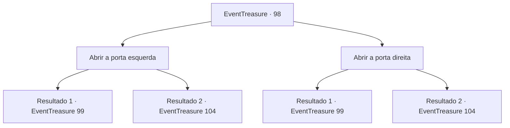

# Eventos de tesouro · 98

[Índice da tabela](index.md) · [Índice geral](../index.md)

ID: `pt:EventTreasure:98` · Fonte: `EventTreasure4` · Versão: 1.2.47.

Mapeamento estático dos arquivos; a disponibilidade e a execução dependem do estado da run.

## Texto do evento

*Sem texto no arquivo.*

## Dados de entrada

```json
{
  "id": 98,
  "grade": 1,
  "place": "",
  "required": ""
}
```

## Mapa das escolhas



## Escolhas e resultados

### Escolha 1

Abrir a porta esquerda

Requisitos e outros campos da escolha:

```json
{
  "required": ""
}
```

#### Resultado 1.1

Quando você abre a porta e sai, outro corredor escuro e frio segue em frente. Você caminha pelo corredor por um tempo, chegando a uma sala espaçosa. Uma forma de fogo ardente está desenhada em sua entrada, e as paredes estão todas queimadas, com fuligem espalhada seguindo um padrão. De repente, o calor é sentido do centro da sala. Um incêndio surge em seguida, e um elemental de fogo aparece.

Continuação registrada: [Evento 99](0099.md) na mesma tabela.

```json
{
  "required": "",
  "chance": "1",
  "nextEvent": 99,
  "type": 2,
  "reward": ""
}
```

#### Resultado 1.2

Quando você abre a porta e sai, outro corredor escuro e frio segue em frente. No final do corredor, há uma porta com o desenho de um soldado gravemente ferido. Quando você abre a porta e entra, ela se expande em um grande espaço circular. O desenho de um diabinho com um sorriso grotesco está desenhado na entrada. Quando você entra na sala vazia desagradável, você escuta uma voz falando em sua cabeça. 

 "Caro ​​desafiante, você quer o caminho curto, mas doloroso, ou o caminho longo, mas fácil? Se você quiser o primeiro escolha a porta esquerda, e se quiser o segundo escolha a porta direita."

 Como disse a voz, há duas portas fechadas na sala.

Continuação registrada: [Evento 104](0104.md) na mesma tabela.

```json
{
  "required": "",
  "chance": "1",
  "nextEvent": 104,
  "type": 2,
  "reward": ""
}
```

### Escolha 2

Abrir a porta direita

Requisitos e outros campos da escolha:

```json
{
  "required": ""
}
```

#### Resultado 2.1

Quando você abre a porta e sai, outro corredor escuro e frio segue em frente. Você caminha pelo corredor por um tempo, chegando a uma sala espaçosa.  Uma forma de fogo ardente está desenhada em sua entrada,  e as paredes estão todas queimadas, com fuligem espalhada seguindo um padrão.  De repente, o calor é sentido do centro da sala. Um incêndio surge em seguida, e um elemental de fogo aparece.

Continuação registrada: [Evento 99](0099.md) na mesma tabela.

```json
{
  "required": "",
  "chance": "1",
  "nextEvent": 99,
  "type": 2,
  "reward": ""
}
```

#### Resultado 2.2

Quando você abre a porta e sai, outro corredor escuro e frio segue em frente. No final do corredor, há uma porta com o desenho de um soldado gravemente ferido. Quando você abre a porta e entra, ela se expande em um grande espaço circular. O desenho de um diabinho com um sorriso grotesco está desenhado na entrada. Quando você entra na sala vazia desagradável, você escuta uma voz falando em sua cabeça. 

 "Caro ​​desafiante, você quer o caminho curto, mas doloroso, ou o caminho longo, mas fácil? Se você quiser o primeiro escolha a porta esquerda, e se quiser o segundo escolha a porta direita."

 Como disse a voz, há duas portas fechadas na sala.

Continuação registrada: [Evento 104](0104.md) na mesma tabela.

```json
{
  "required": "",
  "chance": "1",
  "nextEvent": 104,
  "type": 2,
  "reward": ""
}
```

## Referências que chegam a este evento

- [Evento 97 · escolha 1 · resultado 1](0097.md#escolha-1)
