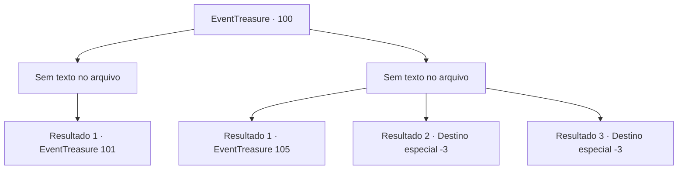

# Eventos de tesouro · 100

[Índice da tabela](index.md) · [Índice geral](../index.md)

ID: `pt:EventTreasure:100` · Fonte: `EventTreasure4` · Versão: 1.2.47.

Mapeamento estático dos arquivos; a disponibilidade e a execução dependem do estado da run.

## Texto do evento

*Sem texto no arquivo.*

## Dados de entrada

```json
{
  "id": 100,
  "grade": 1,
  "place": "",
  "required": ""
}
```

## Mapa das escolhas



## Escolhas e resultados

### Escolha 1

*Sem texto no arquivo; o papel dessa opção depende da interface do jogo.*

Requisitos e outros campos da escolha:

```json
{
  "required": ""
}
```

#### Resultado 1.1

Você derrota o elemental de fogo após uma longa luta, então uma nova porta se abre.  Quando você abre a porta e sai, outro corredor escuro e frio segue em frente.  O corredor escuro fede a sinistro.  Você anda por muito tempo. Então, de repente, o cheiro desagradável desaparece e uma aura refrescante o envolve.  A entrada de uma sala aparece diante de você. Na entrada, encontra-se o desenho de um unicórnio branco.  A sala em que você entra desta vez é um lindo jardim, pequeno mas bem organizado.  A luz prateada do teto ilumina a fonte no centro da sala e seus arredores,  e no meio da fonte jorra água límpida.

Continuação registrada: [Evento 101](0101.md) na mesma tabela.

```json
{
  "required": "",
  "chance": "1",
  "nextEvent": 101,
  "type": 2,
  "reward": ""
}
```

### Escolha 2

*Sem texto no arquivo; o papel dessa opção depende da interface do jogo.*

Requisitos e outros campos da escolha:

```json
{
  "required": ""
}
```

#### Resultado 2.1

Você é derrotado pelo elemental de fogo após uma longa luta. Conforme o vencedor é determinado, o elemental do fogo desaparece e uma porta oculta se revela na parte de trás. Quando você abre a porta e sai, outro corredor escuro e frio segue em frente.

 No final do corredor, há uma porta velha e surrada que você abre e entra. Ao sentir algo nos seus pés, você descobre que são pedaços quebrados de várias armas. Uma lâmina já enferrujada, pedaços de madeira podre que parecem cabos de um machado ou uma lança, fragmentos de escudos estilhaçados, etc. Então, uma pessoa que estava se enrolando no chão cambaleia e fica de pé. 

 "Um desafiante..."

 A cada passo que ele dá em sua direção, o barulho desagradável das pontas das espadas se arrastando no chão pode ser ouvido. 

 "Derrote-me, se quiser passar. De qualquer maneira, não há escolha. Sucumba ao seu destino."

 Ele puxa sua arma enquanto fala coisas sem sentido.

Continuação registrada: [Evento 105](0105.md) na mesma tabela.

```json
{
  "required": "1_0_2|1_1_2",
  "chance": "1",
  "nextEvent": 105,
  "type": 2,
  "reward": "0_0_-1|0_1_-1"
}
```

#### Resultado 2.2

Você é engolido pelo elemental de fogo após uma longa luta.  Nele, você é transformado em um monte de cinzas pretas.

Continuação registrada: [Destino especial `-3`](../destinos-especiais.md).

```json
{
  "required": "2_0_2",
  "chance": "1",
  "nextEvent": -3,
  "type": 2,
  "reward": "0_0_-1|0_1_-1"
}
```

#### Resultado 2.3

Você é engolido pelo elemental de fogo após uma longa luta.  Nele, você é transformado em um monte de cinzas pretas.

Continuação registrada: [Destino especial `-3`](../destinos-especiais.md).

```json
{
  "required": "2_1_2",
  "chance": "1",
  "nextEvent": -3,
  "type": 2,
  "reward": "0_0_-1|0_1_-1"
}
```

## Referências que chegam a este evento

- [Evento 99 · escolha 1 · resultado 1](0099.md#escolha-1)
