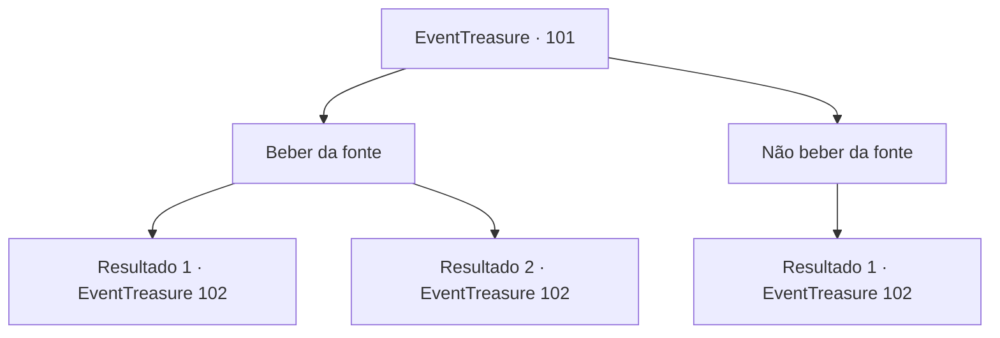

# Eventos de tesouro · 101

[Índice da tabela](index.md) · [Índice geral](../index.md)

ID: `pt:EventTreasure:101` · Fonte: `EventTreasure4` · Versão: 1.2.47.

Mapeamento estático dos arquivos; a disponibilidade e a execução dependem do estado da run.

## Texto do evento

*Sem texto no arquivo.*

## Dados de entrada

```json
{
  "id": 101,
  "grade": 1,
  "place": "",
  "required": ""
}
```

## Mapa das escolhas



## Escolhas e resultados

### Escolha 1

Beber da fonte

Requisitos e outros campos da escolha:

```json
{
  "required": "1_1_2"
}
```

#### Resultado 1.1

Você bebe a água da fonte. A água refrescante mata sua sede e limpa sua mente. Você sai da sala parecida com um jardim. Quando você abre a porta e sai, outro corredor escuro e frio segue em frente. Uma clara presença de fogo pode ser sentida do outro lado do corredor escuro. Você caminha em direção à próxima entrada. O desenho de um leão que ruge pode ser encontrado na entrada. Quando você abre a porta e entra, um enorme espaço aberto, que você prefere chamar de caverna subterrânea gigante em vez de uma sala, aparece. Muitos depósitos de estalactites e dripstones, meio desintegrados, estão espalhados pelo chão seco. <color=red><link=shake>

 "GRRAAWWWWRRRR!!"

</link></color> O rugido de um monstro gigante pode ser ouvido acima de sua cabeça. Quando você olha para cima, uma mantícora está olhando para você, pendurada no teto.

Continuação registrada: [Evento 102](0102.md) na mesma tabela.

```json
{
  "required": "",
  "chance": "1",
  "nextEvent": 102,
  "type": 2,
  "reward": "0_1_1"
}
```

#### Resultado 1.2

Você bebe a água da fonte. O líquido frio queima seu esôfago e causa dor. Você tosse o líquido misterioso e sai da sala que parece um jardim. Quando você abre a porta e sai, outro corredor escuro e frio segue em frente. Uma clara presença de fogo pode ser sentida do outro lado do corredor escuro. Você caminha em direção à próxima entrada. O desenho de um leão que ruge pode ser encontrado na entrada. Quando você abre a porta e entra, um enorme espaço aberto, que você prefere chamar de caverna subterrânea gigante em vez de uma sala, aparece. Muitos depósitos de estalactites e dripstones, meio desintegrados, estão espalhados pelo chão seco. <color=red><link=shake>

 "GRRAAWWWWRRRR!!"

</link></color> O rugido de um monstro gigante pode ser ouvido acima de sua cabeça. Quando você olha para cima, uma mantícora está olhando para você, pendurada no teto.

Continuação registrada: [Evento 102](0102.md) na mesma tabela.

```json
{
  "required": "",
  "chance": "1",
  "nextEvent": 102,
  "type": 2,
  "reward": "0_1_-1"
}
```

### Escolha 2

Não beber da fonte

Requisitos e outros campos da escolha:

```json
{
  "required": ""
}
```

#### Resultado 2.1

Você sente uma premonição repentina e decide não beber da fonte. Em seguida, você sai da sala semelhante a um jardim. Quando você abre a porta e sai, outro corredor escuro e frio segue em frente. Uma clara presença de fogo pode ser sentida do outro lado do corredor escuro. Você caminha em direção à próxima entrada. O desenho de um leão que ruge pode ser encontrado na entrada. Quando você abre a porta e entra, um enorme espaço aberto, que você prefere chamar de caverna subterrânea gigante em vez de uma sala, aparece. Muitos depósitos de estalactites e dripstones, meio desintegrados, estão espalhados pelo chão seco. <color=red><link=shake>

 "GRRAAWWWWRRRR!!"

</link></color> O rugido de um monstro gigante pode ser ouvido acima de sua cabeça. Quando você olha para cima, uma mantícora está olhando para você, pendurada no teto.

Continuação registrada: [Evento 102](0102.md) na mesma tabela.

```json
{
  "required": "",
  "chance": "1",
  "nextEvent": 102,
  "type": 2,
  "reward": ""
}
```

## Referências que chegam a este evento

- [Evento 100 · escolha 1 · resultado 1](0100.md#escolha-1)
