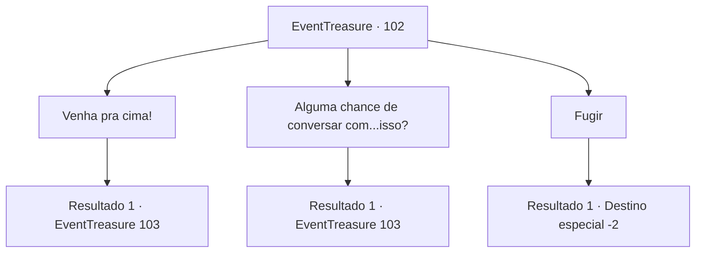

# Eventos de tesouro · 102

[Índice da tabela](index.md) · [Índice geral](../index.md)

ID: `pt:EventTreasure:102` · Fonte: `EventTreasure4` · Versão: 1.2.47.

Mapeamento estático dos arquivos; a disponibilidade e a execução dependem do estado da run.

## Texto do evento

*Sem texto no arquivo.*

## Dados de entrada

```json
{
  "id": 102,
  "grade": 1,
  "place": "",
  "required": ""
}
```

## Mapa das escolhas



## Escolhas e resultados

### Escolha 1

Venha pra cima!

Requisitos e outros campos da escolha:

```json
{
  "required": ""
}
```

#### Resultado 1.1


 "Grrrrrr....!"

  A mantícora aceita seu desafio.

Continuação registrada: [Evento 103](0103.md) na mesma tabela.

```json
{
  "required": "",
  "chance": "1",
  "nextEvent": 103,
  "type": 2,
  "reward": "6_0_96",
  "place": 6
}
```

### Escolha 2

Alguma chance de conversar com...isso?

Requisitos e outros campos da escolha:

```json
{
  "required": ""
}
```

#### Resultado 2.1

Você tenta falar com a mantícora.  Mas, em vez de uma resposta, ela ataca você com a boca bem aberta.

Continuação registrada: [Evento 103](0103.md) na mesma tabela.

```json
{
  "required": "",
  "chance": "1",
  "nextEvent": 103,
  "type": 2,
  "reward": "6_0_96",
  "place": 6
}
```

### Escolha 3

Fugir

Requisitos e outros campos da escolha:

```json
{
  "required": ""
}
```

#### Resultado 3.1

Você vira as costas para a mantícora e foge.  Com um piscar de olhos (literalmente), você se encontra de volta à entrada do labirinto.  

 "Seu desafio termina aqui. Até a próxima."

  A misteriosa pessoa desaparece com um adeus.

Continuação registrada: [Destino especial `-2`](../destinos-especiais.md).

```json
{
  "required": "",
  "chance": "1",
  "nextEvent": -2,
  "type": 2,
  "reward": "5_152_1|0_2_1"
}
```

## Referências que chegam a este evento

- [Evento 101 · escolha 1 · resultado 1](0101.md#escolha-1)
- [Evento 101 · escolha 1 · resultado 2](0101.md#escolha-1)
- [Evento 101 · escolha 2 · resultado 1](0101.md#escolha-2)
