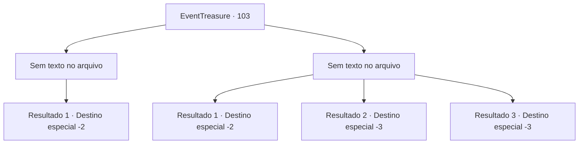

# Eventos de tesouro · 103

[Índice da tabela](index.md) · [Índice geral](../index.md)

ID: `pt:EventTreasure:103` · Fonte: `EventTreasure4` · Versão: 1.2.47.

Mapeamento estático dos arquivos; a disponibilidade e a execução dependem do estado da run.

## Texto do evento

*Sem texto no arquivo.*

## Dados de entrada

```json
{
  "id": 103,
  "grade": 1,
  "place": "",
  "required": ""
}
```

## Mapa das escolhas



## Escolhas e resultados

### Escolha 1

*Sem texto no arquivo; o papel dessa opção depende da interface do jogo.*

Requisitos e outros campos da escolha:

```json
{
  "required": ""
}
```

#### Resultado 1.1

Assim que você derrota a mantícora, após uma longa luta, uma nova porta se abre. O que você vê quando abre a porta é a pessoa misteriosa que o deixou entrar no labirinto. 

 "Bem-vindo ao final do labirinto. Oh, bravo, você é digno desta recompensa."

 Em suas mãos, uma bolsa cheia de moedas de ouro você segurava. Ele se despede de você, curvando-se um tanto exageradamente. 

 "Adeus então."

 Com um estalar de dedos, o mundo ao seu redor fica escuro de repente. Um momento depois, quando você olha ao seu redor com atenção, você vê as planícies escuras. É aqui que você entrou no labirinto pela primeira vez. Mas você não vê nada, nem o homem misterioso que sugeriu que você entrasse na masmorra, nem a entrada escura que levava à ela. Talvez você teve um curto sonho, ou tudo foi apenas sua imaginação. Mas a pesada bolsa de ouro em suas mãos prova que é realmente tudo aconteceu.

Continuação registrada: [Destino especial `-2`](../destinos-especiais.md).

```json
{
  "required": "",
  "chance": "1",
  "nextEvent": -2,
  "type": 2,
  "reward": "0_4_150|5_152_1"
}
```

### Escolha 2

*Sem texto no arquivo; o papel dessa opção depende da interface do jogo.*

Requisitos e outros campos da escolha:

```json
{
  "required": ""
}
```

#### Resultado 2.1

No momento de sua derrota, a última coisa de que você se lembra é a cauda com ferrão da mantícora.
 Você sente sua morte e assume uma postura defensiva.
 ......
 Mas o ferrão nunca chega até você. Quando você olha ao seu redor com cuidado, você vê as planícies escuras. É aqui que você entrou no labirinto pela primeira vez. Mas você não vê nada, nem o homem misterioso que sugeriu que você entrasse na masmorra, nem a entrada escura que levava à ela.

Continuação registrada: [Destino especial `-2`](../destinos-especiais.md).

```json
{
  "required": "1_0_2|1_1_2",
  "chance": "1",
  "nextEvent": -2,
  "type": 2,
  "reward": "5_152_1|0_2_1|0_0_-1|0_1_-1"
}
```

#### Resultado 2.2

No momento de sua derrota, a última coisa de que você se lembra é a cauda com ferrão da mantícora. Ela perfura seu abdômen e injeta sua toxina. Você perde a consciência com a sensação de todo o seu corpo sendo eletrocutado.

Continuação registrada: [Destino especial `-3`](../destinos-especiais.md).

```json
{
  "required": "2_0_2",
  "chance": "1",
  "nextEvent": -3,
  "type": 2,
  "reward": "0_0_-1|0_1_-1"
}
```

#### Resultado 2.3

No momento de sua derrota, a última coisa de que você se lembra é a cauda com ferrão da mantícora.  Ela perfura seu abdômen e injeta sua toxina.  Você perde a consciência com a sensação de todo o seu corpo sendo eletrocutado.

Continuação registrada: [Destino especial `-3`](../destinos-especiais.md).

```json
{
  "required": "2_1_2",
  "chance": "1",
  "nextEvent": -3,
  "type": 2,
  "reward": "0_0_-1|0_1_-1"
}
```

## Referências que chegam a este evento

- [Evento 102 · escolha 1 · resultado 1](0102.md#escolha-1)
- [Evento 102 · escolha 2 · resultado 1](0102.md#escolha-2)
