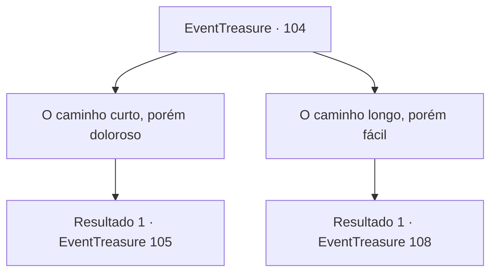

# Eventos de tesouro · 104

[Índice da tabela](index.md) · [Índice geral](../index.md)

ID: `pt:EventTreasure:104` · Fonte: `EventTreasure4` · Versão: 1.2.47.

Mapeamento estático dos arquivos; a disponibilidade e a execução dependem do estado da run.

## Texto do evento

*Sem texto no arquivo.*

## Dados de entrada

```json
{
  "id": 104,
  "grade": 1,
  "place": "",
  "required": ""
}
```

## Mapa das escolhas



## Escolhas e resultados

### Escolha 1

O caminho curto, porém doloroso

Requisitos e outros campos da escolha:

```json
{
  "required": ""
}
```

#### Resultado 1.1

Você escolhe o caminho curto, porém doloroso.
 Quando você abre a porta e sai, outro corredor escuro e frio segue em frente.

 No final do corredor, há uma porta velha e surrada que você abre e entra. Ao sentir algo nos seus pés, você descobre que são pedaços quebrados de várias armas. Uma lâmina já enferrujada, pedaços de madeira podre que parecem cabos de um machado ou uma lança, fragmentos de escudos estilhaçados, etc. Então, uma pessoa que estava se enrolando no chão cambaleia e fica de pé. 

 "Um desafiante..."

 A cada passo que ele dá em sua direção, o barulho desagradável das pontas das espadas se arrastando no chão pode ser ouvido. 

 "Derrote-me, se quiser passar. De qualquer maneira, não há escolha. Sucumba ao seu destino."

 Ele puxa sua arma enquanto fala coisas sem sentido.

Continuação registrada: [Evento 105](0105.md) na mesma tabela.

```json
{
  "required": "",
  "chance": "1",
  "nextEvent": 105,
  "type": 2,
  "reward": ""
}
```

### Escolha 2

O caminho longo, porém fácil

Requisitos e outros campos da escolha:

```json
{
  "required": ""
}
```

#### Resultado 2.1

Você escolhe o caminho longo, porém fácil.
 Quando você abre a porta e sai, outro corredor escuro e frio segue em frente. No final do corredor, há uma porta com o desenho de um troll levantando os braços no ar. Quando você abre a porta e entra, um cheiro horrível que se assemelha a uma toalha encharcada de água podre o ataca. Um chão alagado semelhante a um pântano, fragmentos de ossos meio afundados com sinais de mordidas ao redor deles, e no meio de tudo, um troll gigante de pé.

Continuação registrada: [Evento 108](0108.md) na mesma tabela.

```json
{
  "required": "",
  "chance": "1",
  "nextEvent": 108,
  "type": 2,
  "reward": ""
}
```

## Referências que chegam a este evento

- [Evento 98 · escolha 1 · resultado 2](0098.md#escolha-1)
- [Evento 98 · escolha 2 · resultado 2](0098.md#escolha-2)
