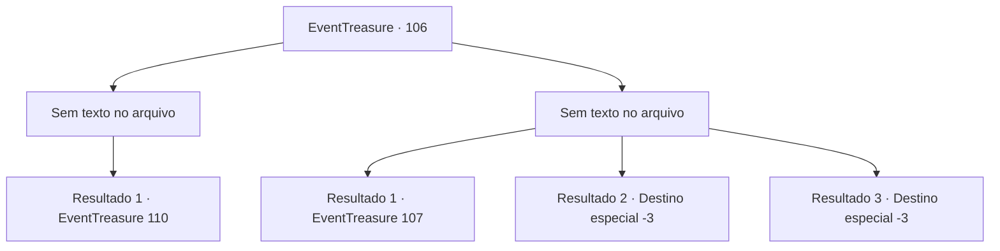

# Eventos de tesouro · 106

[Índice da tabela](index.md) · [Índice geral](../index.md)

ID: `pt:EventTreasure:106` · Fonte: `EventTreasure4` · Versão: 1.2.47.

Mapeamento estático dos arquivos; a disponibilidade e a execução dependem do estado da run.

## Texto do evento

*Sem texto no arquivo.*

## Dados de entrada

```json
{
  "id": 106,
  "grade": 1,
  "place": "",
  "required": ""
}
```

## Mapa das escolhas



## Escolhas e resultados

### Escolha 1

*Sem texto no arquivo; o papel dessa opção depende da interface do jogo.*

Requisitos e outros campos da escolha:

```json
{
  "required": ""
}
```

#### Resultado 1.1

O cavaleiro, mortalmente ferido, rola pelo chão de dor. 

 "Urghh...."

 Depois de se deitar por um tempo, ele se levanta e volta ao centro da sala. Ele então se senta enrolado como quando você entrou pela primeira vez na sala. Ele aponta para um lado da sala sem dizer nada e, de repente, outra porta se abre. Quando você abre a porta e sai, outro corredor escuro e frio segue em frente. Está totalmente silencioso. Dentro da sala, onde parece que o próprio ar afundou, muitas espadas estão presas aqui e ali, sem um padrão. Além da tumba de espadas, há duas portas.

Continuação registrada: [Evento 110](0110.md) na mesma tabela.

```json
{
  "required": "",
  "chance": "1",
  "nextEvent": 110,
  "type": 2,
  "reward": ""
}
```

### Escolha 2

*Sem texto no arquivo; o papel dessa opção depende da interface do jogo.*

Requisitos e outros campos da escolha:

```json
{
  "required": ""
}
```

#### Resultado 2.1

Quando sua derrota está selada, o cavaleiro embainha sua arma. Ele retorna ao centro da sala e se senta em silêncio. Ele aponta para um lado da sala sem dizer nada e, de repente, outra porta se abre. Quando você abre a porta e sai, outro corredor escuro e frio segue em frente. Depois de caminhar um pouco, você se depara com uma porta com o desenho de uma ponte em forma de arco. Quando você abre a porta e entra, você encontra um poço sem fundo que se assemelha ao próprio abismo. Parece que a única forma de atravessar este poço é a ponte de pedras, com cada base distanciada umas das outras cerca de 10 cm.

Continuação registrada: [Evento 107](0107.md) na mesma tabela.

```json
{
  "required": "1_0_2|1_1_2",
  "chance": "1",
  "nextEvent": 107,
  "type": 2,
  "reward": "0_0_-1|0_1_-1"
}
```

#### Resultado 2.2

Quando sua derrota está selada, o cavaleiro embainha sua arma. Ele retorna ao centro da sala e se senta em silêncio. Ele aponta para um lado da sala sem dizer nada e, de repente, outra porta se abre. Quando você abre a porta e sai, outro corredor escuro e frio segue em frente. Você deu alguns passos na parede do corredor escuro, mas logo desabou.

Continuação registrada: [Destino especial `-3`](../destinos-especiais.md).

```json
{
  "required": "2_0_2",
  "chance": "1",
  "nextEvent": -3,
  "type": 2,
  "reward": "0_0_-1|0_1_-1"
}
```

#### Resultado 2.3

Quando sua derrota está selada, o cavaleiro embainha sua arma. Ele retorna ao centro da sala e se senta em silêncio.  Ele aponta para um lado da sala sem dizer nada e, de repente, outra porta se abre.  Quando você abre a porta e sai, outro corredor escuro e frio segue em frente.  Você deu alguns passos na parede do corredor escuro, mas logo desabou.

Continuação registrada: [Destino especial `-3`](../destinos-especiais.md).

```json
{
  "required": "2_1_2",
  "chance": "1",
  "nextEvent": -3,
  "type": 2,
  "reward": "0_0_-1|0_1_-1"
}
```

## Referências que chegam a este evento

- [Evento 105 · escolha 1 · resultado 1](0105.md#escolha-1)
