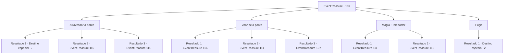

# Eventos de tesouro · 107

[Índice da tabela](index.md) · [Índice geral](../index.md)

ID: `pt:EventTreasure:107` · Fonte: `EventTreasure4` · Versão: 1.2.47.

Mapeamento estático dos arquivos; a disponibilidade e a execução dependem do estado da run.

## Texto do evento

*Sem texto no arquivo.*

## Dados de entrada

```json
{
  "id": 107,
  "grade": 1,
  "place": "",
  "required": ""
}
```

## Mapa das escolhas



## Escolhas e resultados

### Escolha 1

Atravessar a ponte

Requisitos e outros campos da escolha:

```json
{
  "required": ""
}
```

#### Resultado 1.1

Você cuidadosamente pisa na estreita ponte de pedra.  Mas você dá um passo errado e, em vez de chegar ao fim, cai no abismo infinito das trevas.  Com um piscar de olhos (literalmente), você se encontra de volta à entrada do labirinto.  

 "Seu desafio termina aqui. Até a próxima."

  A misteriosa pessoa desaparece com um adeus.

Continuação registrada: [Destino especial `-2`](../destinos-especiais.md).

```json
{
  "required": "",
  "chance": "26",
  "nextEvent": -2,
  "type": 1,
  "reward": "5_152_1|0_2_1"
}
```

#### Resultado 1.2

Com cuidado, você pisa na estreita ponte de pedra e, com sentidos impecáveis de equilíbrio, atravessa a ponte de pedra. No final há uma porta. Quando você abre a porta e sai, outro corredor escuro e frio segue em frente. Depois de caminhar por um tempo, você abre a porta para a próxima sala. Você sente o cheiro da água do mar ao entrar. Surpreendentemente, a sala consiste em um lago gigante. Ondas atingem a rocha em que você está. Ao longe, do outro lado do lago, você vê uma porta. A única coisa que conecta isso a você é uma ponte feita de pranchas de madeira presas com pregos e cordas. A aparência da ponte não é exatamente promissora, e ela se move para cima e para baixo conforme a onda. Você pisa cuidadosamente nas pranchas de madeira. Quando estava na metade do caminho, você escuta uma voz em sua cabeça. 

 "Oh, bravo aventureiro, o caminho que você percorreu até agora é tão importante quanto o caminho que você seguirá no futuro. Agora, você se lembra do número de quartos que você teve que cruzar para chegar a este?"


Continuação registrada: [Evento 116](0116.md) na mesma tabela.

```json
{
  "required": "",
  "chance": "1|0_6_1",
  "nextEvent": 116,
  "type": 0,
  "reward": ""
}
```

#### Resultado 1.3

Com cuidado, você pisa na estreita ponte de pedra e, com sentidos impecáveis de equilíbrio, atravessa a ponte de pedra. No final há uma porta. Quando você abre a porta e entra, sente uma forte rajada de vento e, após alguns minutos de caminhada, uma enorme parede de um castelo de pedra aparece. Parece os restos de um castelo colossal, e nas paredes podem ser vistos os sinais de batalha. As armaduras e as armas espalhadas abaixo dele ganham vida. Eles estão mortos há muito tempo, mas aparentemente ainda não escaparam do senso de dever de proteger o castelo.

Continuação registrada: [Evento 111](0111.md) na mesma tabela.

```json
{
  "required": "",
  "chance": "1|0_6_1",
  "nextEvent": 111,
  "type": 0,
  "reward": ""
}
```

### Escolha 2

Voar pela ponte

Requisitos e outros campos da escolha:

```json
{
  "required": "5_172_0"
}
```

#### Resultado 2.1

Você se lança no ar e voa para o outro lado. No final há uma porta. Quando você abre a porta e sai, outro corredor escuro e frio segue em frente. Depois de caminhar por um tempo, você abre a porta para a próxima sala. Você sente o cheiro da água do mar ao entrar. Surpreendentemente, a sala consiste em um lago gigante. Ondas atingem a rocha em que você está. Ao longe, do outro lado do lago, você vê uma porta. A única coisa que conecta isso a você é uma ponte feita de pranchas de madeira presas com pregos e cordas. A aparência da ponte não é exatamente promissora, e ela se move para cima e para baixo conforme a onda. Você pisa cuidadosamente nas pranchas de madeira. Quando estava na metade do caminho, você escuta uma voz em sua cabeça. 

 "Oh, bravo aventureiro, o caminho que você percorreu até agora é tão importante quanto o caminho que você seguirá no futuro. Agora, você se lembra do número de quartos que você teve que cruzar para chegar a este?"


Continuação registrada: [Evento 116](0116.md) na mesma tabela.

```json
{
  "required": "20_10_1",
  "chance": "1",
  "nextEvent": 116,
  "type": 2,
  "reward": ""
}
```

#### Resultado 2.2

Você usa magia para voar para o outro lado. No final há uma porta. Quando você abre a porta e entra, sente uma forte rajada de vento e, após alguns minutos de caminhada, uma enorme parede de um castelo de pedra aparece. Parece os restos de um castelo colossal, e nas paredes podem ser vistos os sinais de batalha. As armaduras e as armas espalhadas abaixo dele ganham vida. Eles estão mortos há muito tempo, mas aparentemente ainda não escaparam do senso de dever de proteger o castelo.

Continuação registrada: [Evento 111](0111.md) na mesma tabela.

```json
{
  "required": "20_0_1",
  "chance": "1",
  "nextEvent": 111,
  "type": 2,
  "reward": ""
}
```

#### Resultado 2.3

Você pensou que seria bom sobrevoar, mas não havia jeito.  Tem que haver outra maneira.

Continuação registrada: [Evento 107](0107.md) na mesma tabela.

```json
{
  "required": "21_0_1|21_10_1",
  "chance": "1",
  "nextEvent": 107,
  "type": 2,
  "reward": "5_172_1"
}
```

### Escolha 3

Magia : Teleportar

Requisitos e outros campos da escolha:

```json
{
  "required": "20_0_4|1_1_2"
}
```

#### Resultado 3.1

Você usa magia para se teletransportar para o outro lado. No final há uma porta. Quando você abre a porta e entra, sente uma forte rajada de vento e, após alguns minutos de caminhada, uma enorme parede de um castelo de pedra aparece. Parece os restos de um castelo colossal, e nas paredes podem ser vistos os sinais de batalha. As armaduras e as armas espalhadas abaixo dele ganham vida. Eles estão mortos há muito tempo, mas aparentemente ainda não escaparam do senso de dever de proteger o castelo.

Continuação registrada: [Evento 111](0111.md) na mesma tabela.

```json
{
  "required": "",
  "chance": "1",
  "nextEvent": 111,
  "type": 2,
  "reward": "0_1_-1"
}
```

#### Resultado 3.2

Você usa magia para se teletransportar para o outro lado. No final há uma porta. Quando você abre a porta e sai, outro corredor escuro e frio segue em frente. Depois de caminhar por um tempo, você abre a porta para a próxima sala. Você sente o cheiro da água do mar ao entrar. Surpreendentemente, a sala consiste em um lago gigante. Ondas atingem a rocha em que você está. Ao longe, do outro lado do lago, você vê uma porta. A única coisa que conecta isso a você é uma ponte feita de pranchas de madeira presas com pregos e cordas. A aparência da ponte não é exatamente promissora, e ela se move para cima e para baixo conforme a onda. Você pisa cuidadosamente nas pranchas de madeira. Quando estava na metade do caminho, você escuta uma voz em sua cabeça. 

 "Oh, bravo aventureiro, o caminho que você percorreu até agora é tão importante quanto o caminho que você seguirá no futuro. Agora, você se lembra do número de quartos que você teve que cruzar para chegar a este?"


Continuação registrada: [Evento 116](0116.md) na mesma tabela.

```json
{
  "required": "",
  "chance": "1",
  "nextEvent": 116,
  "type": 2,
  "reward": "0_1_-1"
}
```

### Escolha 4

Fugir

Requisitos e outros campos da escolha:

```json
{
  "required": ""
}
```

#### Resultado 4.1

Você se afasta da estreita ponte de pedra.  Com um piscar de olhos (literalmente), você se encontra de volta à entrada do labirinto.  

 "Seu desafio termina aqui. Até a próxima."

  A misteriosa pessoa desaparece com um adeus.

Continuação registrada: [Destino especial `-2`](../destinos-especiais.md).

```json
{
  "required": "",
  "chance": "1",
  "nextEvent": -2,
  "type": 2,
  "reward": "5_152_1|0_2_1"
}
```

## Referências que chegam a este evento

- [Evento 106 · escolha 2 · resultado 1](0106.md#escolha-2)
- [Evento 107 · escolha 2 · resultado 3](0107.md#escolha-2)
