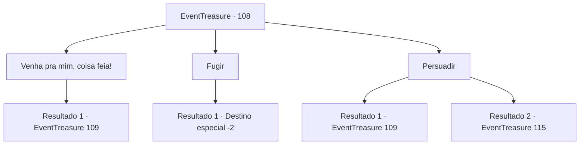

# Eventos de tesouro · 108

[Índice da tabela](index.md) · [Índice geral](../index.md)

ID: `pt:EventTreasure:108` · Fonte: `EventTreasure4` · Versão: 1.2.47.

Mapeamento estático dos arquivos; a disponibilidade e a execução dependem do estado da run.

## Texto do evento

*Sem texto no arquivo.*

## Dados de entrada

```json
{
  "id": 108,
  "grade": 1,
  "place": "",
  "required": ""
}
```

## Mapa das escolhas



## Escolhas e resultados

### Escolha 1

Venha pra mim, coisa feia!

Requisitos e outros campos da escolha:

```json
{
  "required": ""
}
```

#### Resultado 1.1

Você grita com o troll.  Ele aceita prontamente seu desafio.  

 "CWARRRGGHHH! VOCÊ! EU DESTRUIR EM PEDAÇOS!!"


Continuação registrada: [Evento 109](0109.md) na mesma tabela.

```json
{
  "required": "",
  "chance": "1",
  "nextEvent": 109,
  "type": 2,
  "reward": "6_3_9",
  "place": 10
}
```

### Escolha 2

Fugir

Requisitos e outros campos da escolha:

```json
{
  "required": ""
}
```

#### Resultado 2.1

Você foge do troll.  Com um piscar de olhos (literalmente), você se encontra de volta à entrada do labirinto.  

 "Seu desafio termina aqui. Até a próxima."

  A misteriosa pessoa desaparece com um adeus.

Continuação registrada: [Destino especial `-2`](../destinos-especiais.md).

```json
{
  "required": "",
  "chance": "1",
  "nextEvent": -2,
  "type": 2,
  "reward": "5_152_1|0_2_1"
}
```

### Escolha 3

Persuadir

Requisitos e outros campos da escolha:

```json
{
  "required": ""
}
```

#### Resultado 3.1

Você pede ao troll para deixá-lo passar sem lutar.  Mas o troll coça a cabeça, sem dizer nada.  E quando você termina, ele pega sua clava.  

 "Eu não entender! VOCÊ! NÃO PASSAR AQUI!"


Continuação registrada: [Evento 109](0109.md) na mesma tabela.

```json
{
  "required": "",
  "chance": "8",
  "nextEvent": 109,
  "type": 1,
  "reward": "6_0_9",
  "place": 10
}
```

#### Resultado 3.2

Você conseguiu persuadir o troll. 

 "Mmmm... okay."

 Você passa pelo troll, que fica te olhando enquanto você anda. Você abre a porta e caminha pelo corredor escuro novamente, alcançando a porta para a próxima sala. Na porta há três linhas, aparentemente representando o vento. No momento em que você abre a porta e entra, um vento refrescante o envolve. A sala está cheia de juncos da altura da sua cintura. Você vai para o campo de juncos, um tanto estressado. Mas parece que não há nada hostil. Depois de caminhar um pouco, você vê uma porta do outro lado. Você abre a porta e segue para o corredor.

Continuação registrada: [Evento 115](0115.md) na mesma tabela.

```json
{
  "required": "",
  "chance": "1|0_7_1",
  "nextEvent": 115,
  "type": 0,
  "reward": ""
}
```

## Referências que chegam a este evento

- [Evento 104 · escolha 2 · resultado 1](0104.md#escolha-2)
