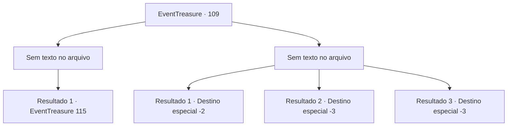

# Eventos de tesouro · 109

[Índice da tabela](index.md) · [Índice geral](../index.md)

ID: `pt:EventTreasure:109` · Fonte: `EventTreasure4` · Versão: 1.2.47.

Mapeamento estático dos arquivos; a disponibilidade e a execução dependem do estado da run.

## Texto do evento

*Sem texto no arquivo.*

## Dados de entrada

```json
{
  "id": 109,
  "grade": 1,
  "place": "",
  "required": ""
}
```

## Mapa das escolhas



## Escolhas e resultados

### Escolha 1

*Sem texto no arquivo; o papel dessa opção depende da interface do jogo.*

Requisitos e outros campos da escolha:

```json
{
  "required": ""
}
```

#### Resultado 1.1

Você passa pelo troll inconsciente para a próxima porta.  Você abre a porta e caminha pelo corredor escuro novamente, alcançando a porta para a próxima sala.  Na porta há três linhas, aparentemente representando o vento.  No momento em que você abre a porta e entra, um vento refrescante o envolve. A sala está cheia de juncos da altura da sua cintura.  Você vai para o campo de juncos, um tanto estressado. Mas parece que não há nada hostil. Depois de caminhar um pouco, você vê uma porta do outro lado.  Você abre a porta e segue para o corredor.

Continuação registrada: [Evento 115](0115.md) na mesma tabela.

```json
{
  "required": "",
  "chance": "1",
  "nextEvent": 115,
  "type": 2,
  "reward": ""
}
```

### Escolha 2

*Sem texto no arquivo; o papel dessa opção depende da interface do jogo.*

Requisitos e outros campos da escolha:

```json
{
  "required": ""
}
```

#### Resultado 2.1

Enquanto você está ocupado esquivando-se dos ataques do troll, você vê a clava gigante do troll vindo em sua direção. Mas, no momento decisivo, o troll não se move. E a próxima coisa que você sente é você mesmo sendo jogado no ar, com tudo escurecendo. Você pisca. Quando você olha ao seu redor com atenção, você vê as planícies escuras. É aqui que você entrou no labirinto pela primeira vez. Mas você não vê nada, nem o homem misterioso que sugeriu que você entrasse na masmorra, nem a entrada escura que levava à ela.

Continuação registrada: [Destino especial `-2`](../destinos-especiais.md).

```json
{
  "required": "1_0_2|1_1_2",
  "chance": "1",
  "nextEvent": -2,
  "type": 2,
  "reward": "0_0_-1|0_1_-1|5_152_1"
}
```

#### Resultado 2.2

Enquanto você está ocupado esquivando-se dos ataques do troll,  você vê a clava gigante do troll vindo em sua direção.  Um som de estalo ecoa em seus ouvidos. É o som do seu crânio sendo esmagado.

Continuação registrada: [Destino especial `-3`](../destinos-especiais.md).

```json
{
  "required": "2_0_2",
  "chance": "1",
  "nextEvent": -3,
  "type": 2,
  "reward": "0_0_-1|0_1_-1"
}
```

#### Resultado 2.3

Enquanto você está ocupado esquivando-se dos ataques do troll,  você vê a clava gigante do troll vindo em sua direção.  Um som de estalo ecoa em seus ouvidos. É o som do seu crânio sendo esmagado.

Continuação registrada: [Destino especial `-3`](../destinos-especiais.md).

```json
{
  "required": "2_1_2",
  "chance": "1",
  "nextEvent": -3,
  "type": 2,
  "reward": "0_0_-1|0_1_-1"
}
```

## Referências que chegam a este evento

- [Evento 108 · escolha 1 · resultado 1](0108.md#escolha-1)
- [Evento 108 · escolha 3 · resultado 1](0108.md#escolha-3)
