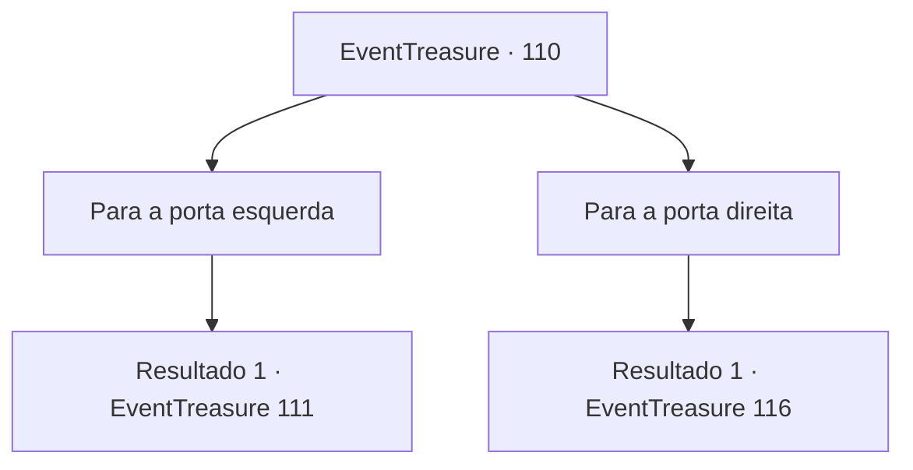

# Eventos de tesouro · 110

[Índice da tabela](index.md) · [Índice geral](../index.md)

ID: `pt:EventTreasure:110` · Fonte: `EventTreasure4` · Versão: 1.2.47.

Mapeamento estático dos arquivos; a disponibilidade e a execução dependem do estado da run.

## Texto do evento

*Sem texto no arquivo.*

## Dados de entrada

```json
{
  "id": 110,
  "grade": 1,
  "place": "",
  "required": ""
}
```

## Mapa das escolhas



## Escolhas e resultados

### Escolha 1

Para a porta esquerda

Requisitos e outros campos da escolha:

```json
{
  "required": ""
}
```

#### Resultado 1.1

Quando você abre a porta e entra, sente uma forte rajada de vento e, após alguns minutos de caminhada, uma enorme parede de um castelo de pedra aparece. Parece os restos de um castelo colossal, e nas paredes podem ser vistos os sinais de batalha. As armaduras e as armas espalhadas por baixo ganham vida. Eles estão mortos há muito tempo, mas aparentemente ainda não escaparam do senso de dever de proteger o castelo.

Continuação registrada: [Evento 111](0111.md) na mesma tabela.

```json
{
  "required": "",
  "chance": "1",
  "nextEvent": 111,
  "type": 2,
  "reward": ""
}
```

### Escolha 2

Para a porta direita

Requisitos e outros campos da escolha:

```json
{
  "required": ""
}
```

#### Resultado 2.1

Quando você abre a porta e sai, outro corredor escuro e frio segue em frente. Depois de caminhar por um tempo, você abre a porta para a próxima sala. Você sente o cheiro da água do mar ao entrar. Surpreendentemente, a sala consiste em um lago gigante. Ondas atingem a rocha em que você está. Longe, do outro lado do lago, você vê uma porta. A única coisa que conecta isso a você é uma ponte feita de pranchas de madeira presas com pregos e cordas. A aparência da ponte não é exatamente promissora e ela se move para cima e para baixo conforme a onda. Você pisa cuidadosamente nas pranchas de madeira. Quando você estava na metade do caminho, escuta uma voz em sua cabeça. 

 "Oh, bravo aventureiro, o caminho que você percorreu até agora é tão importante quanto o caminho que você seguirá no futuro. Agora, você se lembra do número de quartos que você teve que cruzar para chegar a este?"


Continuação registrada: [Evento 116](0116.md) na mesma tabela.

```json
{
  "required": "",
  "chance": "1",
  "nextEvent": 116,
  "type": 2,
  "reward": ""
}
```

## Referências que chegam a este evento

- [Evento 106 · escolha 1 · resultado 1](0106.md#escolha-1)
