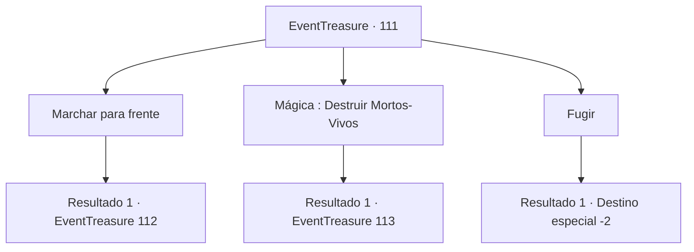

# Eventos de tesouro · 111

[Índice da tabela](index.md) · [Índice geral](../index.md)

ID: `pt:EventTreasure:111` · Fonte: `EventTreasure4` · Versão: 1.2.47.

Mapeamento estático dos arquivos; a disponibilidade e a execução dependem do estado da run.

## Texto do evento

*Sem texto no arquivo.*

## Dados de entrada

```json
{
  "id": 111,
  "grade": 1,
  "place": "",
  "required": ""
}
```

## Mapa das escolhas



## Escolhas e resultados

### Escolha 1

Marchar para frente

Requisitos e outros campos da escolha:

```json
{
  "required": ""
}
```

#### Resultado 1.1

Os mortos caminham em sua direção.  'Clank, clank..'
  As armaduras e as armas se chocam, fazendo barulho.

Continuação registrada: [Evento 112](0112.md) na mesma tabela.

```json
{
  "required": "",
  "chance": "1",
  "nextEvent": 112,
  "type": 2,
  "reward": "6_0_78",
  "place": 0
}
```

### Escolha 2

Mágica : Destruir Mortos-Vivos

Requisitos e outros campos da escolha:

```json
{
  "required": "20_0_1|20_3_1"
}
```

#### Resultado 2.1

Você lança um encantamento para devolver os mortos ao submundo. Você é o único que está no caminho ventoso para as paredes do castelo. Você abre a porta do lado oposto e entra no corredor escuro. Lá você se depara com outra porta.

 Um símbolo que representa um dragão pode ser visto na frente da porta. Você abre a porta com cuidado e entra. No meio da sala construída com blocos de pedra preta, há um dragão gigante com escamas vermelhas brilhantes. Você não consegue evitar e suspira ao ver a criatura magnífica. O dragão olha para você e prepara o fogo em sua boca.

Continuação registrada: [Evento 113](0113.md) na mesma tabela.

```json
{
  "required": "",
  "chance": "1",
  "nextEvent": 113,
  "type": 2,
  "reward": ""
}
```

### Escolha 3

Fugir

Requisitos e outros campos da escolha:

```json
{
  "required": ""
}
```

#### Resultado 3.1

Você foge dos mortos. Com um piscar de olhos (literalmente), você se encontra de volta à entrada do labirinto.  

 "Seu desafio termina aqui. Até a próxima."

  A misteriosa pessoa desaparece com um adeus.

Continuação registrada: [Destino especial `-2`](../destinos-especiais.md).

```json
{
  "required": "",
  "chance": "1",
  "nextEvent": -2,
  "type": 2,
  "reward": "5_152_1|0_2_1"
}
```

## Referências que chegam a este evento

- [Evento 107 · escolha 1 · resultado 3](0107.md#escolha-1)
- [Evento 107 · escolha 2 · resultado 2](0107.md#escolha-2)
- [Evento 107 · escolha 3 · resultado 1](0107.md#escolha-3)
- [Evento 110 · escolha 1 · resultado 1](0110.md#escolha-1)
