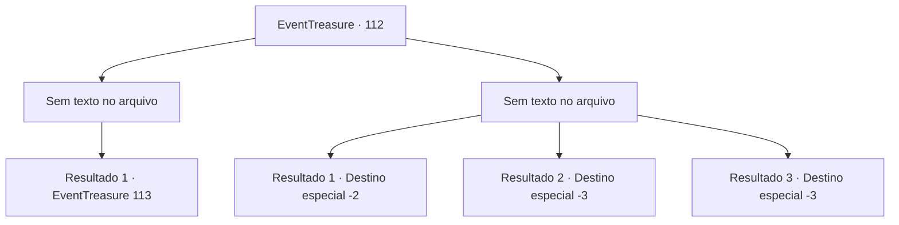

# Eventos de tesouro · 112

[Índice da tabela](index.md) · [Índice geral](../index.md)

ID: `pt:EventTreasure:112` · Fonte: `EventTreasure4` · Versão: 1.2.47.

Mapeamento estático dos arquivos; a disponibilidade e a execução dependem do estado da run.

## Texto do evento

*Sem texto no arquivo.*

## Dados de entrada

```json
{
  "id": 112,
  "grade": 1,
  "place": "",
  "required": ""
}
```

## Mapa das escolhas



## Escolhas e resultados

### Escolha 1

*Sem texto no arquivo; o papel dessa opção depende da interface do jogo.*

Requisitos e outros campos da escolha:

```json
{
  "required": ""
}
```

#### Resultado 1.1

Os mortos agora estão livres da armadilha que os prendia ao reino mortal e são transformados em cinzas. Você é o único que está no caminho ventoso para as paredes do castelo. Você abre a porta do lado oposto e entra no corredor escuro. Lá você se depara com outra porta.

 Um símbolo que representa um dragão pode ser visto na frente da porta. Você abre a porta com cuidado e entra. No meio da sala construída com blocos de pedra preta, há um dragão gigante com escamas vermelhas brilhantes. Você não consegue evitar e suspira ao ver a criatura magnífica. O dragão olha para você e prepara o fogo em sua boca.

Continuação registrada: [Evento 113](0113.md) na mesma tabela.

```json
{
  "required": "",
  "chance": "1",
  "nextEvent": 113,
  "type": 2,
  "reward": ""
}
```

### Escolha 2

*Sem texto no arquivo; o papel dessa opção depende da interface do jogo.*

Requisitos e outros campos da escolha:

```json
{
  "required": ""
}
```

#### Resultado 2.1

Os guerreiros esqueléticos cercam você desajeitadamente, erguendo suas armas enferrujadas acima de suas cabeças.  No momento em que as espadas deles o atingem, você se sente lançado ao ar e cercado pela escuridão.  Quando você abre os olhos e olha ao redor com cuidado, você vê as planícies escuras. É aqui que você entrou no labirinto pela primeira vez.  Mas você não vê nada, nem o homem misterioso que sugeriu que você entrasse na masmorra, nem a entrada escura que levava à ela.

Continuação registrada: [Destino especial `-2`](../destinos-especiais.md).

```json
{
  "required": "1_0_2|1_1_2",
  "chance": "1",
  "nextEvent": -2,
  "type": 2,
  "reward": "0_0_-1|0_1_-1|5_152_1"
}
```

#### Resultado 2.2

Os guerreiros esqueléticos cercam você desajeitadamente, erguendo suas armas enferrujadas acima de suas cabeças.  Eles simplesmente atacam você, acabando com sua vida.

Continuação registrada: [Destino especial `-3`](../destinos-especiais.md).

```json
{
  "required": "2_0_2",
  "chance": "1",
  "nextEvent": -3,
  "type": 2,
  "reward": "0_0_-1|0_1_-1"
}
```

#### Resultado 2.3

Os guerreiros esqueléticos cercam você desajeitadamente, erguendo suas armas enferrujadas acima de suas cabeças.  Eles simplesmente atacam você, acabando com sua vida.

Continuação registrada: [Destino especial `-3`](../destinos-especiais.md).

```json
{
  "required": "2_1_2",
  "chance": "1",
  "nextEvent": -3,
  "type": 2,
  "reward": "0_0_-1|0_1_-1"
}
```

## Referências que chegam a este evento

- [Evento 111 · escolha 1 · resultado 1](0111.md#escolha-1)
