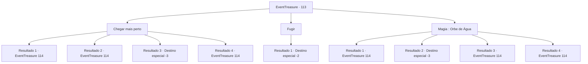

# Eventos de tesouro · 113

[Índice da tabela](index.md) · [Índice geral](../index.md)

ID: `pt:EventTreasure:113` · Fonte: `EventTreasure4` · Versão: 1.2.47.

Mapeamento estático dos arquivos; a disponibilidade e a execução dependem do estado da run.

## Texto do evento

*Sem texto no arquivo.*

## Dados de entrada

```json
{
  "id": 113,
  "grade": 1,
  "place": "",
  "required": ""
}
```

## Mapa das escolhas



## Escolhas e resultados

### Escolha 1

Chegar mais perto

Requisitos e outros campos da escolha:

```json
{
  "required": ""
}
```

#### Resultado 1.1

Você acha que o dragão vermelho vai soltar fogo. Então você corre até ele, para diminuir a distância entre você e o corpo dele. Mas você não consegue se esquivar do sopro. O fogo abrasador queima suas roupas e pele.

Continuação registrada: [Evento 114](0114.md) na mesma tabela.

```json
{
  "required": "1_0_2|21_13_3",
  "chance": "13",
  "nextEvent": 114,
  "type": 1,
  "reward": "6_0_52|0_0_-1",
  "place": 10
}
```

#### Resultado 1.2

A chama do dragão vermelho dispara e você corre para se esquivar.  

 "Ágil... Agora, corra mais um pouco!"

  O dragão grita e ataca você.

Continuação registrada: [Evento 114](0114.md) na mesma tabela.

```json
{
  "required": "",
  "chance": "1|0_6_1",
  "nextEvent": 114,
  "type": 0,
  "reward": "6_0_52",
  "place": 10
}
```

#### Resultado 1.3

Você acha que o dragão vermelho vai soltar fogo. Então você corre até ele, para diminuir a distância entre você e o corpo dele. Mas você não consegue se esquivar do sopro e, como resultado, se torna uma pilha de cinzas.

Continuação registrada: [Destino especial `-3`](../destinos-especiais.md).

```json
{
  "required": "2_0_2|21_13_3",
  "chance": "1",
  "nextEvent": -3,
  "type": 2,
  "reward": "0_0_-1"
}
```

#### Resultado 1.4

Você acha que o dragão vermelho vai cuspir fogo. Então você corre em direção a ele, para diminuir a distância entre você e seu corpo. Seus pés não são mais rápidos que o sopro, e as chamas envolvem seu corpo. No entanto, você as atravessa e avança contra o dragão vermelho.

Continuação registrada: [Evento 114](0114.md) na mesma tabela.

```json
{
  "required": "20_13_3",
  "chance": "1",
  "nextEvent": 114,
  "type": 1,
  "reward": ""
}
```

### Escolha 2

Fugir

Requisitos e outros campos da escolha:

```json
{
  "required": ""
}
```

#### Resultado 2.1

Você vira as costas e foge do dragão. O sopro do dragão o persegue por trás, emitindo uma grande quantidade de calor. Logo antes de ser engolido pelo fogo, você está cercado pela escuridão. Quando você pisca, você se encontra de volta à entrada do labirinto. 

 "Você fez bem. Isso... será suficiente como recompensa. Agora, se você me der licença."

 O homem misterioso que o guiou até o labirinto remexe nos bolsos e tira uma bolsa de couro. Depois de entregá-la a você, ele desaparece sem deixar vestígios, e o mesmo acontece com a entrada da masmorra, como se nunca tivesse existido.

Continuação registrada: [Destino especial `-2`](../destinos-especiais.md).

```json
{
  "required": "",
  "chance": "1",
  "nextEvent": -2,
  "type": 2,
  "reward": "0_2_1|0_4_100|5_152_1"
}
```

### Escolha 3

Magia : Orbe de Água

Requisitos e outros campos da escolha:

```json
{
  "required": "20_0_3|1_1_2"
}
```

#### Resultado 3.1

Você tenta lançar um feitiço para tecer uma orbe de água, mas não consegue fazê-la por causa do nervosismo. Chove fogo e você consegue rolar, evitando virar um monte de cinzas.

Continuação registrada: [Evento 114](0114.md) na mesma tabela.

```json
{
  "required": "1_0_2|21_13_3",
  "chance": "11",
  "nextEvent": 114,
  "type": 1,
  "reward": "6_0_52|0_0_-1|0_1_-1",
  "place": 10
}
```

#### Resultado 3.2

Você tenta lançar um feitiço para tecer uma orbe de água, mas não consegue fazê-la por causa do nervosismo. Chove fogo e você virou uma pilha de cinzas.

Continuação registrada: [Destino especial `-3`](../destinos-especiais.md).

```json
{
  "required": "2_0_2|21_13_3",
  "chance": "11",
  "nextEvent": -3,
  "type": 1,
  "reward": "0_0_-1|0_1_-1"
}
```

#### Resultado 3.3

Você lança um feitiço e tece uma orbe feita de água.  Ela bate no fogo do dragão e evapora, criando um vapor branco.  

 "Cahahaha! Você conhece alguns truques interessantes!"

  O dragão dá uma gargalhada maníaca e bate as asas.  O vento poderoso empurra o vapor para longe, e através dele o dragão vem voando.

Continuação registrada: [Evento 114](0114.md) na mesma tabela.

```json
{
  "required": "21_13_3",
  "chance": "1|0_14_1",
  "nextEvent": 114,
  "type": 0,
  "reward": "6_0_52",
  "place": 10
}
```

#### Resultado 3.4

Você tenta lançar um feitiço para tecer um orbe de água, mas falha em fazer isso por nervosismo. Fogo chove, mas você não sofre nenhum dano.

Continuação registrada: [Evento 114](0114.md) na mesma tabela.

```json
{
  "required": "20_13_3",
  "chance": "1",
  "nextEvent": 114,
  "type": 1,
  "reward": ""
}
```

## Referências que chegam a este evento

- [Evento 111 · escolha 2 · resultado 1](0111.md#escolha-2)
- [Evento 112 · escolha 1 · resultado 1](0112.md#escolha-1)
