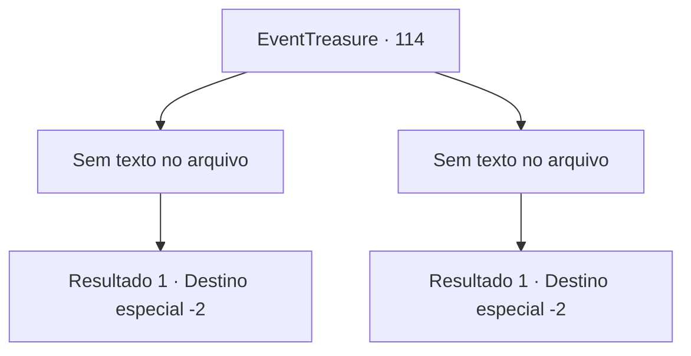

# Eventos de tesouro · 114

[Índice da tabela](index.md) · [Índice geral](../index.md)

ID: `pt:EventTreasure:114` · Fonte: `EventTreasure4` · Versão: 1.2.47.

Mapeamento estático dos arquivos; a disponibilidade e a execução dependem do estado da run.

## Texto do evento

*Sem texto no arquivo.*

## Dados de entrada

```json
{
  "id": 114,
  "grade": 1,
  "place": "",
  "required": ""
}
```

## Mapa das escolhas



## Escolhas e resultados

### Escolha 1

*Sem texto no arquivo; o papel dessa opção depende da interface do jogo.*

Requisitos e outros campos da escolha:

```json
{
  "required": ""
}
```

#### Resultado 1.1

Você derrota o dragão vermelho e passa pela nova porta. Quando você abre a porta e sai, outro corredor escuro e frio segue em frente. No final do longo corredor, você encontra uma pesada porta de carvalho luxuosamente decorada. Ao abrir a porta, você vê uma árvore enorme e linda, e a pessoa misteriosa que você viu ao entrar na masmorra. 

 "Bem-vindo ao fim do labirinto, oh Grande. Você é digno desta recompensa."

 A árvore parece ter vivido por mais ou menos mil anos, e há uma espada enfiada nela, que, quando você se aproxima, desliza suavemente. O guia do labirinto entrega a você a espada e fala. 

 "Esta espada tem o apelido de 'Grande Tristeza'. Ela testemunhou a glória e a queda de muitos heróis. Agora, eu me pergunto que tipo de glória e queda você mostrará."

 Ele se despede de você, curvando-se um tanto exageradamente. 

 "Adeus, então."

 Com um estalar de dedos, o mundo ao seu redor fica escuro de repente. Um momento depois, quando você olha ao seu redor com atenção, você vê as planícies escuras. É aqui que você entrou no labirinto pela primeira vez. Mas você não vê nada, nem o homem misterioso que sugeriu que você entrasse na masmorra, nem a entrada escura que levava à ela. Talvez você teve um curto sonho, ou tudo foi apenas sua imaginação. Mas a espada em suas mãos prova que realmente tudo aconteceu.

Continuação registrada: [Destino especial `-2`](../destinos-especiais.md).

```json
{
  "required": "",
  "chance": "1",
  "nextEvent": -2,
  "type": 2,
  "reward": "3_69_1|0_2_1|5_152_1"
}
```

### Escolha 2

*Sem texto no arquivo; o papel dessa opção depende da interface do jogo.*

Requisitos e outros campos da escolha:

```json
{
  "required": ""
}
```

#### Resultado 2.1

Você cai no chão rochoso preto. O sopro quente do dragão vermelho toca seu rosto.  Ele abre suas mandíbulas e tenta engoli-lo.  Naquele momento, você se encontra de volta à entrada do labirinto.  

 "Você fez bem. Isso... será suficiente como recompensa. Agora, se você me der licença."

  O homem misterioso que o guiou até o labirinto remexe nos bolsos e tira uma bolsa de couro.  Depois de entregá-la a você, ele desaparece sem deixar vestígios,  e o mesmo acontece com a entrada da masmorra, como se não existisse desde o início.

Continuação registrada: [Destino especial `-2`](../destinos-especiais.md).

```json
{
  "required": "",
  "chance": "1",
  "nextEvent": -2,
  "type": 2,
  "reward": "0_2_1|0_4_100|5_152_1"
}
```

## Referências que chegam a este evento

- [Evento 113 · escolha 1 · resultado 1](0113.md#escolha-1)
- [Evento 113 · escolha 1 · resultado 2](0113.md#escolha-1)
- [Evento 113 · escolha 1 · resultado 4](0113.md#escolha-1)
- [Evento 113 · escolha 3 · resultado 1](0113.md#escolha-3)
- [Evento 113 · escolha 3 · resultado 3](0113.md#escolha-3)
- [Evento 113 · escolha 3 · resultado 4](0113.md#escolha-3)
