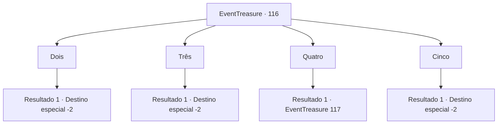

# Eventos de tesouro · 116

[Índice da tabela](index.md) · [Índice geral](../index.md)

ID: `pt:EventTreasure:116` · Fonte: `EventTreasure4` · Versão: 1.2.47.

Mapeamento estático dos arquivos; a disponibilidade e a execução dependem do estado da run.

## Texto do evento

*Sem texto no arquivo.*

## Dados de entrada

```json
{
  "id": 116,
  "grade": 1,
  "place": "",
  "required": ""
}
```

## Mapa das escolhas



## Escolhas e resultados

### Escolha 1

Dois

Requisitos e outros campos da escolha:

```json
{
  "required": ""
}
```

#### Resultado 1.1

Nada acontece após a sua resposta. Assim que você está prestes a se mover, os arredores começam a tremer e a ponte começa a sacudir violentamente. Logo, um tentáculo tão grosso quanto uma tora de madeira sai da água. Tem ventosas quase do tamanho de um rosto humano. Você tenta evitá-lo, mas isso parece impossível na ponte estreita. O tentáculo gigante agarra você e o joga no ar. Enquanto você puxa sua arma, recusando-se a morrer assim, você percebe que o ambiente mudou. Quando você abre os olhos, olha ao redor com cuidado, você vê as planícies escuras. É aqui que você entrou no labirinto pela primeira vez. Mas você não vê nada, nem o homem misterioso que sugeriu que você entrasse na masmorra, nem a entrada escura que levava à ela.

Continuação registrada: [Destino especial `-2`](../destinos-especiais.md).

```json
{
  "required": "",
  "chance": "1",
  "nextEvent": -2,
  "type": 2,
  "reward": "5_152_1"
}
```

### Escolha 2

Três

Requisitos e outros campos da escolha:

```json
{
  "required": ""
}
```

#### Resultado 2.1

Nada acontece após a sua resposta. Assim que você está prestes a se mover, os arredores começam a tremer e a ponte começa a sacudir violentamente. Logo, um tentáculo tão grosso quanto uma tora de madeira sai da água. Tem ventosas quase do tamanho de um rosto humano. Você tenta evitá-lo, mas isso parece impossível na ponte estreita. O tentáculo gigante agarra você e o joga no ar. Enquanto você puxa sua arma, recusando-se a morrer assim, você percebe que o ambiente mudou. Quando você abre os olhos, olha ao redor com cuidado, você vê as planícies escuras. É aqui que você entrou no labirinto pela primeira vez. Mas você não vê nada, nem o homem misterioso que sugeriu que você entrasse na masmorra, nem a entrada escura que levava à ela.

Continuação registrada: [Destino especial `-2`](../destinos-especiais.md).

```json
{
  "required": "",
  "chance": "1",
  "nextEvent": -2,
  "type": 2,
  "reward": "5_152_1"
}
```

### Escolha 3

Quatro

Requisitos e outros campos da escolha:

```json
{
  "required": ""
}
```

#### Resultado 3.1

Nada acontece em após a sua resposta. Apenas o som ambiente de uma onda quebrando na ponte em que você está. Depois de avançar lentamente em direção ao outro lado, você abre a porta e continua. A próxima porta após o corredor é um coliseu. Em torno do chão de areia áspera, você consegue ver muitos assentos para o público nas altas paredes de pedra. No passado, vários gladiadores devem ter lutado muito pela glória, em meio à torcida. Mas o lugar parece abandonado há muito tempo, já que não dá para ver ninguém sentado nas cadeiras destroçadas do público. No centro do chão arenoso do coliseu há um 'Gorgo', um touro cujo corpo inteiro é feito de aço. E está bufando com força, pronto para se chocar contra você.

Continuação registrada: [Evento 117](0117.md) na mesma tabela.

```json
{
  "required": "",
  "chance": "1",
  "nextEvent": 117,
  "type": 2,
  "reward": ""
}
```

### Escolha 4

Cinco

Requisitos e outros campos da escolha:

```json
{
  "required": ""
}
```

#### Resultado 4.1

Nada acontece após a sua resposta. Assim que você está prestes a se mover, os arredores começam a tremer e a ponte começa a sacudir violentamente. Logo, um tentáculo tão grosso quanto uma tora de madeira sai da água. Tem ventosas quase do tamanho de um rosto humano. Você tenta evitá-lo, mas isso parece impossível na ponte estreita. O tentáculo gigante agarra você e o joga no ar. Enquanto você puxa sua arma, recusando-se a morrer assim, você percebe que o ambiente mudou. Quando você abre os olhos, olha ao redor com cuidado, você vê as planícies escuras. É aqui que você entrou no labirinto pela primeira vez. Mas você não vê nada, nem o homem misterioso que sugeriu que você entrasse na masmorra, nem a entrada escura que levava à ela.

Continuação registrada: [Destino especial `-2`](../destinos-especiais.md).

```json
{
  "required": "",
  "chance": "1",
  "nextEvent": -2,
  "type": 2,
  "reward": "5_152_1"
}
```

## Referências que chegam a este evento

- [Evento 107 · escolha 1 · resultado 2](0107.md#escolha-1)
- [Evento 107 · escolha 2 · resultado 1](0107.md#escolha-2)
- [Evento 107 · escolha 3 · resultado 2](0107.md#escolha-3)
- [Evento 110 · escolha 2 · resultado 1](0110.md#escolha-2)
- [Evento 115 · escolha 1 · resultado 1](0115.md#escolha-1)
