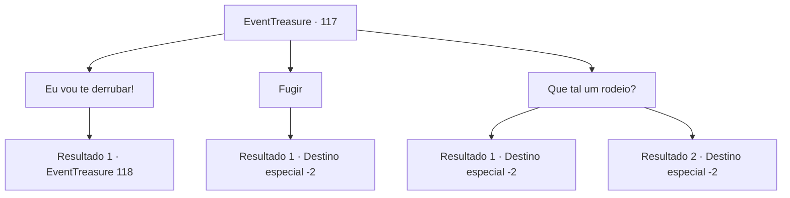

# Eventos de tesouro · 117

[Índice da tabela](index.md) · [Índice geral](../index.md)

ID: `pt:EventTreasure:117` · Fonte: `EventTreasure4` · Versão: 1.2.47.

Mapeamento estático dos arquivos; a disponibilidade e a execução dependem do estado da run.

## Texto do evento

*Sem texto no arquivo.*

## Dados de entrada

```json
{
  "id": 117,
  "grade": 1,
  "place": "",
  "required": ""
}
```

## Mapa das escolhas



## Escolhas e resultados

### Escolha 1

Eu vou te derrubar!

Requisitos e outros campos da escolha:

```json
{
  "required": ""
}
```

#### Resultado 1.1

Esta será uma luta difícil. Conforme você saca sua arma, o Górgon investe contra você.

Continuação registrada: [Evento 118](0118.md) na mesma tabela.

```json
{
  "required": "",
  "chance": "1",
  "nextEvent": 118,
  "type": 2,
  "reward": "6_0_51",
  "place": 11
}
```

### Escolha 2

Fugir

Requisitos e outros campos da escolha:

```json
{
  "required": ""
}
```

#### Resultado 2.1

Você foge do Górgon. Com um piscar de olhos (literalmente), você se encontra de volta à entrada do labirinto. 

 "Seu desafio termina aqui. Até a próxima."

 A misteriosa pessoa desaparece com um adeus.

Continuação registrada: [Destino especial `-2`](../destinos-especiais.md).

```json
{
  "required": "",
  "chance": "1",
  "nextEvent": -2,
  "type": 2,
  "reward": "5_152_1|0_2_1"
}
```

### Escolha 3

Que tal um rodeio?

Requisitos e outros campos da escolha:

```json
{
  "required": ""
}
```

#### Resultado 3.1

Para o touro de aço, você propõe um tipo diferente de luta. Surpreendentemente, ele se aproxima lentamente e se ajoelha, como se estivesse lhe dizendo para andar nele. Quando você monta no touro, ele começa a sacudir o corpo violentamente.
 'STOMP! STOMP! STOMP, STOMP!'
 Incapaz de suportar o movimento violento do gorgo, você cai de costas no chão. Você vê o casco do Górgon diante de seus olhos. Pouco antes de seu rosto ser esmagado, você se encontra na entrada do labirinto. 

 "Você fez bem. Isso... será suficiente como recompensa. Agora, se você me der licença."

 O homem misterioso que o guiou até o labirinto remexe nos bolsos e tira uma bolsa de couro. Depois de entregá-la a você, ele desaparece sem deixar vestígios, e o mesmo acontece com a entrada da masmorra, como se não existisse desde o início.

Continuação registrada: [Destino especial `-2`](../destinos-especiais.md).

```json
{
  "required": "",
  "chance": "22",
  "nextEvent": -2,
  "type": 1,
  "reward": "5_152_1|0_2_1|0_4_100"
}
```

#### Resultado 3.2

Para o touro de aço, você propõe um tipo diferente de luta. Surpreendentemente, ele se aproxima lentamente e se ajoelha, como se estivesse lhe dizendo para andar nele. Quando você monta no touro, ele começa a sacudir o corpo violentamente.
 'STOMP! STOMP! STOMP, STOMP!'
 O Górgon é o primeiro a ficar exausto, e então acaba caindo sobre os seus cascos. Embora não haja audiência, você levanta sua mão direita em vitória. Então a porta do coliseu se abre. Ao abrir a porta limpa, ao contrário das outras anteriores, você vê o misterioso guia da masmorra esperando por você. 

 "Bem-vindo ao fim do labirinto, oh Grande. Você é digno desta recompensa."

 Ele lhe entrega um frasco de poção decorado com metal cortado. 

 "Este é um elixir inestimável, difícil de encontrar em qualquer parte do mundo. Espero que você faça um bom uso."

 Ele se despede de você, curvando-se um tanto exageradamente. Com um estalar de dedos, o ambiente muda em um instante. Quando você olha ao seu redor com atenção, você vê as planícies escuras. É aqui que você entrou no labirinto pela primeira vez. Mas você não vê nada, nem o homem misterioso que sugeriu que você entrasse na masmorra, nem a entrada escura que levava à ela.

Continuação registrada: [Destino especial `-2`](../destinos-especiais.md).

```json
{
  "required": "",
  "chance": "1|0_13_1",
  "nextEvent": -2,
  "type": 0,
  "reward": "3_198_1|5_152_1"
}
```

## Referências que chegam a este evento

- [Evento 116 · escolha 3 · resultado 1](0116.md#escolha-3)
