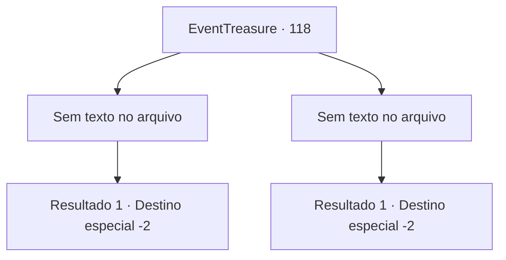

# Eventos de tesouro · 118

[Índice da tabela](index.md) · [Índice geral](../index.md)

ID: `pt:EventTreasure:118` · Fonte: `EventTreasure4` · Versão: 1.2.47.

Mapeamento estático dos arquivos; a disponibilidade e a execução dependem do estado da run.

## Texto do evento

*Sem texto no arquivo.*

## Dados de entrada

```json
{
  "id": 118,
  "grade": 1,
  "place": "",
  "required": ""
}
```

## Mapa das escolhas



## Escolhas e resultados

### Escolha 1

*Sem texto no arquivo; o papel dessa opção depende da interface do jogo.*

Requisitos e outros campos da escolha:

```json
{
  "required": ""
}
```

#### Resultado 1.1

Seus ataques acertam com precisão e o Górgon cambaleia antes de cair sobre os seus cascos. Você prossegue pela porta aberta do outro lado do coliseu. Ao abrir a porta limpa, ao contrário das outras anteriores, você vê o misterioso guia da masmorra esperando por você. 

 "Bem-vindo ao final do labirinto, oh Grande. Você é digno desta recompensa."

 Ele lhe entrega um frasco de poção decorado com metal cortado. 

 "Este é um elixir inestimável, difícil de encontrar em qualquer parte do mundo. Espero que você faça um bom uso."

 Ele se despede de você, curvando-se um tanto exageradamente. Com um estalar de dedos, o ambiente muda em um instante. Quando você olha ao seu redor com atenção, você vê as planícies escuras. É aqui que você entrou no labirinto pela primeira vez. Mas você não vê nada, nem o homem misterioso que sugeriu que você entrasse na masmorra, nem a entrada escura que levava à ela.

Continuação registrada: [Destino especial `-2`](../destinos-especiais.md).

```json
{
  "required": "",
  "chance": "1",
  "nextEvent": -2,
  "type": 2,
  "reward": "3_198_1|5_152_1"
}
```

### Escolha 2

*Sem texto no arquivo; o papel dessa opção depende da interface do jogo.*

Requisitos e outros campos da escolha:

```json
{
  "required": ""
}
```

#### Resultado 2.1

Você vê o casco do Górgon diante de seus olhos. Pouco antes de seu rosto ser esmagado, você se encontra na entrada do labirinto. 

 "Você fez bem. Isso... será suficiente como recompensa. Agora, se você me der licença."

 O homem misterioso que o guiou até o labirinto remexe nos bolsos e tira uma bolsa de couro. Depois de entregá-la a você, ele desaparece sem deixar vestígios, e o mesmo acontece com a entrada da masmorra, como se não existisse desde o início.

Continuação registrada: [Destino especial `-2`](../destinos-especiais.md).

```json
{
  "required": "",
  "chance": "1",
  "nextEvent": -2,
  "type": 2,
  "reward": "5_152_1|0_2_1|0_4_100"
}
```

## Referências que chegam a este evento

- [Evento 117 · escolha 1 · resultado 1](0117.md#escolha-1)
