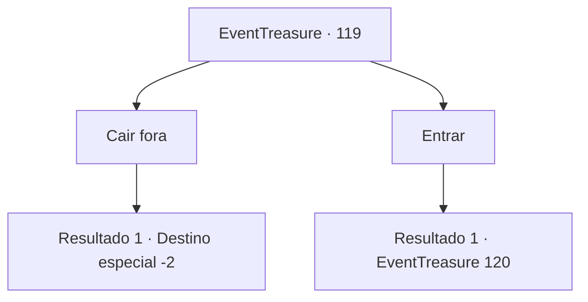

# Eventos de tesouro · 119

[Índice da tabela](index.md) · [Índice geral](../index.md)

ID: `pt:EventTreasure:119` · Fonte: `EventTreasure4` · Versão: 1.2.47.

Mapeamento estático dos arquivos; a disponibilidade e a execução dependem do estado da run.

## Texto do evento

Você encontra uma ruína deserta dentro de uma montanha sem nome. As paredes estão quase completamente desmoronadas, e um golem de ferro guarda o enorme portão de aço. As imagens do portão e do golem ficam borradas. Parece que há dois deles. Você esfrega os olhos, mas não é o cansaço que está causando isso.

## Dados de entrada

```json
{
  "id": 119,
  "grade": 1,
  "place": "",
  "required": "5_271_0"
}
```

## Mapa das escolhas



## Escolhas e resultados

### Escolha 1

Cair fora 

Requisitos e outros campos da escolha:

```json
{
  "required": ""
}
```

#### Resultado 1.1

Você decide procurar outro lugar para dormir. Você se afasta da ruína sinistra.

Continuação registrada: [Destino especial `-2`](../destinos-especiais.md).

```json
{
  "required": "",
  "chance": "1",
  "nextEvent": -2,
  "type": 2,
  "reward": "5_271_9"
}
```

### Escolha 2

Entrar

Requisitos e outros campos da escolha:

```json
{
  "required": ""
}
```

#### Resultado 2.1

Você anda para perto do portão guardado pelo golem. Então, as duas imagens borradas do golem falam. As duas vozes se sobrepõem. 

 "Um de nós sempre conta mentiras. E o outro sempre fala a verdade. Um portão lhe dará algo útil. O outro vai tirar algo útil de você. Para decidir qual portão será mais benéfico para você, você pode fazer uma pergunta."


Continuação registrada: [Evento 120](0120.md) na mesma tabela.

```json
{
  "required": "",
  "chance": "1",
  "nextEvent": 120,
  "type": 2,
  "reward": "5_271_1"
}
```

## Referências que chegam a este evento

Nenhum `nextEvent` positivo da mesma tabela aponta para este nó. Isso não prova que seja inacessível: sorteio e estado de história podem selecioná-lo.

