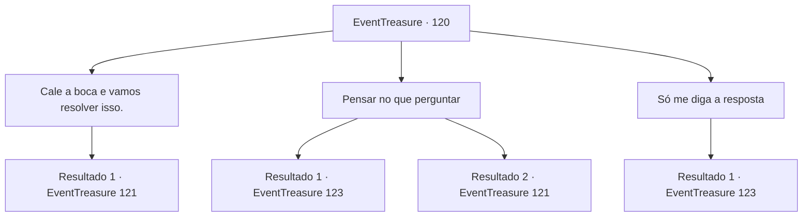

# Eventos de tesouro · 120

[Índice da tabela](index.md) · [Índice geral](../index.md)

ID: `pt:EventTreasure:120` · Fonte: `EventTreasure4` · Versão: 1.2.47.

Mapeamento estático dos arquivos; a disponibilidade e a execução dependem do estado da run.

## Texto do evento

*Sem texto no arquivo.*

## Dados de entrada

```json
{
  "id": 120,
  "grade": 1,
  "place": "",
  "required": ""
}
```

## Mapa das escolhas



## Escolhas e resultados

### Escolha 1

Cale a boca e vamos resolver isso.

Requisitos e outros campos da escolha:

```json
{
  "required": ""
}
```

#### Resultado 1.1

Você decide que isso é uma perda de tempo.  Apesar de mostrar vontade de lutar, o golem não o ataca. Ele fala com calma.  

 "Então, você pode apenas escolher um portão aleatório e entrar."


Continuação registrada: [Evento 121](0121.md) na mesma tabela.

```json
{
  "required": "",
  "chance": "1",
  "nextEvent": 121,
  "type": 2,
  "reward": ""
}
```

### Escolha 2

Pensar no que perguntar

Requisitos e outros campos da escolha:

```json
{
  "required": ""
}
```

#### Resultado 2.1

Depois de pensar com cuidado, você pergunta ao golem à esquerda, apontando para o portão esquerdo. 'Se eu perguntar ao golem da direita, se este é o portão que me dá um presente, ele diria que sim?' O golem à esquerda responde balançando a cabeça. 

 "Não."

 Você pergunta a mesma coisa ao golem à direita. Mas o golem da direita também balança a cabeça. 

 "Não."


Continuação registrada: [Evento 123](0123.md) na mesma tabela.

```json
{
  "required": "",
  "chance": "1|0_14_1|0_7_1",
  "nextEvent": 123,
  "type": 0,
  "reward": ""
}
```

#### Resultado 2.2

Você pensa com cuidado por um longo tempo, mas não consegue fazer uma boa pergunta.  Agora você tem duas opções diante de você.  Volte ou escolha um portão aleatório e entre.  O golem parece não ter intenção de prejudicá-lo.

Continuação registrada: [Evento 121](0121.md) na mesma tabela.

```json
{
  "required": "",
  "chance": "40",
  "nextEvent": 121,
  "type": 1,
  "reward": ""
}
```

### Escolha 3

Só me diga a resposta

Requisitos e outros campos da escolha:

```json
{
  "required": "17_0_2"
}
```

#### Resultado 3.1

Você dá gemas para os dois golens e gentilmente pede a resposta. Os golens de aço, ao invés de responder, jogam as joias para o portão esquerdo.

Continuação registrada: [Evento 123](0123.md) na mesma tabela.

```json
{
  "required": "",
  "chance": "1",
  "nextEvent": 123,
  "type": 2,
  "reward": "5_271_2"
}
```

## Referências que chegam a este evento

- [Evento 119 · escolha 2 · resultado 1](0119.md#escolha-2)
