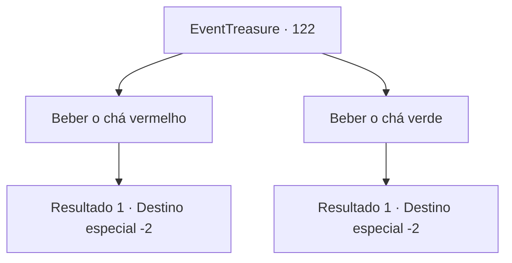

# Eventos de tesouro · 122

[Índice da tabela](index.md) · [Índice geral](../index.md)

ID: `pt:EventTreasure:122` · Fonte: `EventTreasure4` · Versão: 1.2.47.

Mapeamento estático dos arquivos; a disponibilidade e a execução dependem do estado da run.

## Texto do evento

*Sem texto no arquivo.*

## Dados de entrada

```json
{
  "id": 122,
  "grade": 1,
  "place": "",
  "required": ""
}
```

## Mapa das escolhas



## Escolhas e resultados

### Escolha 1

Beber o chá vermelho

Requisitos e outros campos da escolha:

```json
{
  "required": ""
}
```

#### Resultado 1.1

Você escolhe beber o saboroso chá vermelho.  Um cheiro agradável enche seu nariz e você sente seu corpo sendo engolfado pelo calor.  Você se sente muito melhor. Seu corpo fica muito mais leve.  

 "Até a próxima. Espero que você consiga o que deseja."

  Enquanto o orc transparente se despede de você, você se vê de volta ao interior da montanha.  O golem e o portão estão longe de serem vistos.

Continuação registrada: [Destino especial `-2`](../destinos-especiais.md).

```json
{
  "required": "",
  "chance": "1",
  "nextEvent": -2,
  "type": 2,
  "reward": "0_13_1|0_0_1"
}
```

### Escolha 2

Beber o chá verde

Requisitos e outros campos da escolha:

```json
{
  "required": ""
}
```

#### Resultado 2.1

Você escolhe beber o refrescante chá verde.  Você sente que o perfume refrescante está afetando seu cérebro.  Você se sente muito melhor. Sua mente se torna muito mais clara.  

 "Até a próxima. Espero que você consiga o que deseja."

  Enquanto o orc transparente se despede de você, você se vê de volta ao interior da montanha.  O golem e o portão estão longe de serem vistos.

Continuação registrada: [Destino especial `-2`](../destinos-especiais.md).

```json
{
  "required": "",
  "chance": "1",
  "nextEvent": -2,
  "type": 2,
  "reward": "0_14_1|0_1_1"
}
```

## Referências que chegam a este evento

- [Evento 121 · escolha 1 · resultado 3](0121.md#escolha-1)
- [Evento 121 · escolha 2 · resultado 3](0121.md#escolha-2)
- [Evento 123 · escolha 1 · resultado 1](0123.md#escolha-1)
- [Evento 123 · escolha 2 · resultado 3](0123.md#escolha-2)
